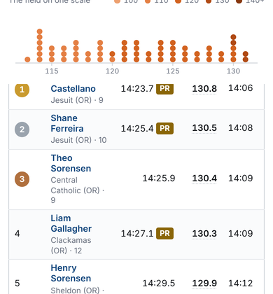
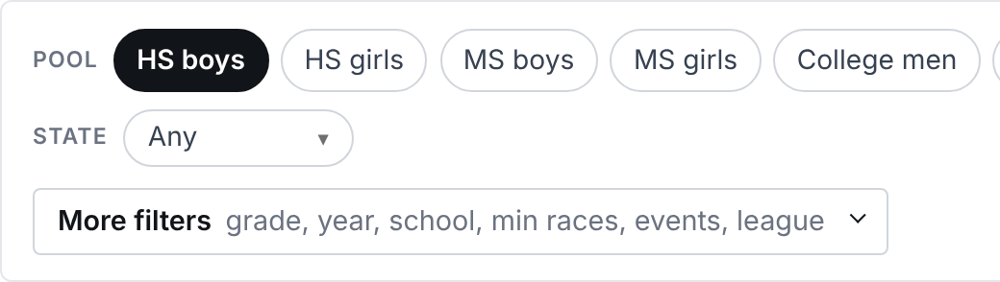
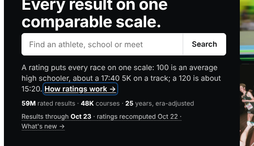

# Racecast accessibility audit, WCAG 2.2 AA (October 2026)

This audit is part of the October UX review. I ran axe-core 4.10 on 25 rendered pages at 390 px and 1280 px. I also checked by hand with Playwright: keyboard walk-throughs, reflow at 400% and 200% zoom, the text-spacing override, pressing Escape on tooltips, overflow inside the phone table boxes, and contrast calculations. Every item below was checked against the code.

---

## 1. Race header cut off on phones: reproduced, cause found

This is very likely the iPhone bug you reported. It happens in Chromium as well, so it is not specific to iOS.

**What happens**
- On a phone, the results box `div.tscroll` has about 90 px of invisible extra height below the table. Measured: scrollHeight 4132 against clientHeight 4040.
- A page opened with `?r=` (every meet link on an athlete page) runs `scrollIntoView({block:"center"})` (`race.html:241-248`).
- That call also scrolls the hidden-overflow box. Its `scrollTop` becomes 82.
- The header row and the top of row 1 slide out of view.
- The box has `overflow-y: hidden`, so the reader **cannot scroll them back**.
- The same happens with `#r…` links from the meet finder (`race-page.js:688`), and probably with `link-flash.js`.

*Scrolled to the top of the table after arriving with `?r=`: no header row, and row 1's first name is gone.*

**Why**
- The phone rule at `style.css:5531-5535` sets `white-space: nowrap; overflow: visible; max-width: none; width: auto` on `div.tscroll > table td *`.
- That rule also matches `.sr-only`, and it is more specific, so it undoes `.sr-only`'s `width: 1px; overflow: hidden` (`style.css:10`).
- Each PR badge's screen-reader sentence ("Personal Record. Their fastest time at this distance…") is therefore laid out at full size. It is invisible, but it still adds to the box's scroll height.
- Hiding the `.sr-only` spans brings scrollHeight back to 4040, which confirms the cause.

**Fix**
1. Exclude the class: `div.tscroll > table td *:not(.sr-only)`. Or make `.sr-only` win, with `!important` on width, height and overflow.
2. Scroll only the window when arriving at a row: `window.scrollTo(0, row.getBoundingClientRect().top + scrollY - offset)`. `scrollIntoView` scrolls every scrollable ancestor, including hidden ones. Land with the table header in view.
3. Optionally give `.tscroll` `overflow-y: clip` instead of `hidden`.

## 2. Contrast

**Text**
- **Track sport tag**: #c8561c on white, 4.37:1 at 10.9 px (athlete and track pages). Fix: #b34a12.
- **#888 text, 3.54:1, 24 uses**:
  - predictions hints (`style.css:2266`);
  - report "(optional)" (`:1625`);
  - **the search dropdown's sub-line `.sr-sub` (`:625`)**, the line that tells two same-named runners apart;
  - rankings `.find-sub` and `.combo-clear`;
  - predictions `.pick-sub`, `.mc-sub`, `.chip-note` and `.runner em`.

  Fix: `var(--muted)` (#6b7280, 4.83:1).
- **#9ca3af text, 2.54:1, 10 uses**: compare `.chart-none`, and `.dist-note-quiet` on course, team season, recruiting school and athlete profile.
- **#bbb text, 1.92:1, 6 uses.**
- **Table headers**: #6b7280 on #f5f5f5 is 4.43:1 at 9.8–12.6 px. It comes from `style.css:193` combined with `:3339`, on conversions and search.
- **School roster `.r-year`**: #767676 on #fafbfc, 4.38:1 at 9.5 px.
- **Medal numerals**: white on gold is **2.58:1**, white on silver **2.56:1** (`style.css:5854-5886`). The numeral is the place, so it counts as text. Fix: dark numerals.

**Non-text and links**
- **Links in running text rely on color alone** (axe `link-in-text-block`, 75 places on compare, course, meet and records). Link navy against body text is 1.95:1, and the links have no underline. Fix: underline links in text.
- **Form field borders**: #cbd0d6 is 1.55:1 and #ccc is 1.61:1 (`style.css:3250`, `race.css:69`, `race.css:72`, rankings chips, meets filters). WCAG asks for 3:1. Fix: #8a929c or darker.
- **Locked rankings filters**: #b4b4ae on #f5f5f2 is 1.91:1, and the 9 px "(select State first)" is 3.47:1 (`style.css:1335-1342`). They aren't actually disabled (section 4).
  - *This corrects the main review: the normal "Any" picker is fine. The 1.9:1 reading belongs to these locked fields.*

## 3. Focus and focus order
- **A visible 2 px focus ring exists everywhere.** Good.
- **The ring disappears on the dark home hero.**
  - #14477d on #0a0c0e is **2.08:1**.
  - The hero search box removes its outline (`style.css:276`) and adds only a faint glow (`:282`).
  - Fix: a white or yellow ring inside the hero.

- **The phone top bar's tab order doesn't match what you see.** On screen it reads logo, Sign in, Menu. Keyboard focus goes logo → Menu → search → Sign in.
- **No skip link on any page.**
  - Desktop has 10 stops before any content.
  - Each race row adds **4 stops** (name, school, PR badge, rating), so a 250-runner race is about 1,000 stops.
  - The Team scores card comes after the table in source order.
  - The athlete page has 45 focusable badges.
- **Fixes:**
  - Add "Skip to results" as the first link.
  - Take badges out of the tab order: `tabindex="-1"`, with the words in `aria-label` and a legend.
  - On phones, put the side card before the table.

## 4. Keyboard and widgets
- **Tabs**: real `role="tab"` / `aria-selected` / tabpanels, but every tab is its own stop and **arrow keys do nothing** (no keydown handler, `race-page.js:120-145`). Add roving tabindex with Left/Right/Home/End, or make them plain links or buttons.
- **The rankings board tabs** have `role="tab"` without panels or `aria-controls` (`rankings.html:77-99`). Make them a segmented control with `aria-pressed`.
- **Race side-card team rows** are a `tr tabindex="0"` with no role, holding a nested `<button>` (`race.html:218-223`).
  - That makes two stops per team.
  - The "lit" state is shown by color only.
  - Fix: one button per team with `aria-pressed`.
- **Locked rankings filters** use only `pointer-events: none` (`style.css:1341`, `rankings.js:2446`), so the keyboard can still open them. Use `disabled` or `aria-disabled`.
- **Search and pickers have no combobox semantics.**
  - Arrow keys move a highlight (`topbar-search.js:110-133`), but nothing is announced.
  - There's no `role="combobox"`, `aria-expanded` or `aria-activedescendant`, no listbox or option roles, and no result count.
  - The same goes for the race find box, the conversions pickers, the compare pickers and the rankings combos.
- **The "How this was rated" sheet** does well on focus: it moves focus in, closes on Escape and returns focus (`rating-explain.js:79-160`). But it has no `aria-modal` and doesn't trap focus. Use `<dialog>.showModal()`, as the team popup already does.
- **The team popup** is named only "Team results". Use `aria-labelledby` pointing at its heading.
- **"Show 20 more"** has no `aria-expanded`, and focus doesn't move to the new rows. "All N teams" does this right (`race-page.js:251-253`).
- **Charts** are labelled by their title only (`athlete-charts.js:521`, `:747`; `race-page.js:342`). Clicking a dot jumps to its row, with **no keyboard equivalent** (`race-page.js:365`, `athlete-charts.js:603`). Give each chart a one-line summary label.

## 5. Tooltips
- The `.flag` and ⓘ tooltips are CSS `::after`, shown on hover and focus (`style.css:1696-1768`). **Escape doesn't close them**, which fails the "dismissible" requirement. The text reaches screen readers through `aria-label`, which is present.
- They're clipped inside phone table boxes. On iOS, whether a tap focuses a `` varies.
- The rating ⓘ is a link to `/scale`.
- Fix: one JS tooltip / bottom-sheet component on `<body>` that closes on Escape and on an outside tap, reusing `rating-explain.js`'s sheet on phones.

## 6. Structure
- Every page has `lang`, one `h1`, `<main>` and a labelled nav. Good.
- **No `<footer>` landmark on any site page.**
- **Skipped heading levels**:
  - course: `h1` → `h4` ("Boys" / "Girls");
  - school: `h1` → `h3`;
  - school PRs and the track meet page: `h1` → `h4`.
- **The race page's results have no heading.** Add a visually hidden `h2` per panel, as the athlete page does.
- **Home has an `<aside>` nested inside another landmark.**
- **Athlete season headings include the rating** ("2026 XC 123.0≈ 15:00"), so a screen reader's heading list reads out numbers.
- **Tables**:
  - None of about 40 has a `<caption>`. Add them on the athlete season tables and the race teams table.
  - The abbreviations "Pl", "Gr" and "Pts" are read letter by letter. Use `<abbr>` or `aria-label`.
  - Rankings sorting is done right: `aria-sort` plus header buttons.

## 7. Forms
- **Conversions**:
  - `#in-distance` has **no label** (axe critical; `conversions.html:119`).
  - The "Course (optional)" label isn't tied to its field (`:125-127`).
  - `#in-result-select` has no label (`:94`); `#add-distance` has a placeholder only (`:272`).
  - Required fields are marked by an asterisk with no `required` attribute (`:44`).
  - Errors are written into a node that isn't a live region (`conversions.js:559-560`), so they aren't announced.
- **Rankings**: six combos (Division, Region, Conference, State division, Section, Section division) have a placeholder and no label.
- **Predictions**: `#athlete-input` and `#squad-input` have placeholders only (`predictions.html:331`, `:341`).
- **School**: the embed `<textarea>` has no label (`school.html:435`) and overflows the page at 200% and 400% zoom.
- **Login, report, contact and uploads**: labelled, with `autocomplete="email"`. Good.
- **Recruiting**: `aria-label` only, no visible labels.

## 8. Status messages and loading
- **Rankings**: boards, the No. 1 line and errors are inserted with no `aria-live` or `aria-busy` (`rankings.js:2008-2015`), so filter changes are silent. Add a polite summary: "Showing 50 of 12,345 HS boys".
- **Silent results**: predictions, recruiting, compare, race find and the search dropdown don't announce what they found.
- **Announced correctly**: the equivalent-time output (`_equiv_line.html:80`), the head-to-head prediction (`_h2h_predict.html:43`), the meet preview panel and search's "load more".

## 9. Page titles
- The rankings title stays "Rankings | Racecast" whatever board is showing; predictions and conversions are the same. Set `document.title` from the same state `syncUrl` writes.
- Search titles use " - Racecast", while the rest use " | Racecast".

## 10. Link text
- **Repeated link text with different destinations**:
  - "View all →" appears 5 times on the course page (`course.html:182`, `:216`, `:252`…);
  - "Boys →" and "Girls →" appear 3 times each on the school page;
  - "XC" and "Track" appear 4 times each in "Rankings by state".
- **Arrows are read aloud**: "→" is read as "right arrow" in "Report it →", "Predict next year →" and others. Wrap them in `aria-hidden`, as home's "View all" already does.

## 11. Target size
- **Flagged by axe**:
  - athlete page: "One-page profile →" (130×16) and the meet links (161×19);
  - home: recent-meet names (19 px tall);
  - school: rank links (46×16).
- **Measured by hand at 390 px**:
  - ⓘ icons: 14×14
  - rank links: 17–34×16
  - badges: 24×17, right next to the rating button
  - Share: 55×24
  - season-jump links: 33×16
  - name links: 15–19 px tall
- Use a minimum of 24 px, and aim for 44 px on touch.

## 12. Zoom and text spacing
- **At 320 px (400% zoom)** only the search page scrolls sideways (368 px wide).
- **Tab strips** on rankings, compare, course, school and recruiting run off the edge with no cue.
- **With the text-spacing override, these clip**:
  - athlete meet names;
  - home "Latest results" names (`.hm-mn`, `.sp`);
  - the home phone header "5K equiv";
  - the meet phone table.

  The hidden text is only available in a `title`, which touch and keyboard users can't reach. Let those cells wrap to two lines.
- **The phone root size is fixed at 14 px** (`style.css`, phone block), so a reader who chose Large text in their browser still gets 14. Use `html { font-size: 87.5% }`.

## 13. Color modes and motion
- **Meaning carried by color only**:
  - lit team rows (no text or ARIA state);
  - selected tabs and chips (a black fill; ARIA is present);
  - row highlights.
- **No `forced-colors` rules.** In Windows High Contrast, the selected tab or chip, the medals, the PR badges and the lit rows become indistinguishable.
- **Smooth scrolling ignores reduced motion**: four `scrollIntoView({behavior: "smooth"})` calls (`race-page.js:141`, `:368`, `:671`, plus one more). Only the rankings and sign-in spinners respect `prefers-reduced-motion` (`style.css:2105`, `:4855`).
- **No dark mode.** Not required, and nothing breaks.

## 14. Names and roles
- **Rating buttons** (`span.rv[role=button]`) are named only by the number ("130.8, button"). Use `aria-label="130.8, how this was rated"`.
- **PR badges** read a full sentence on every row; a short name plus a legend reads better.
- **The distance-corrected ★** (`race.html:58`) is done well: it has an `aria-label` and its link is reachable.
- **Crests** have `alt=""` next to the visible name. Correct.
- **There are no `<abbr>` elements** for XC, TF, HS, MS, PR, SR, CR, R, RSR, DNF, DQ, Pl, Gr or Pts.
