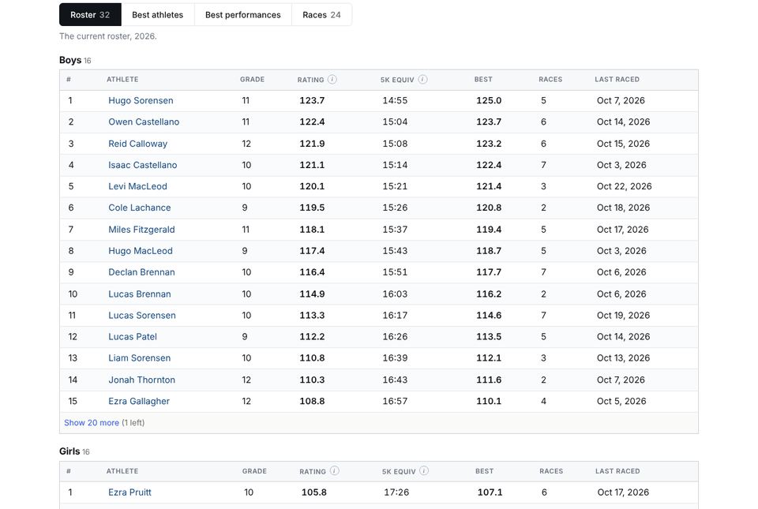
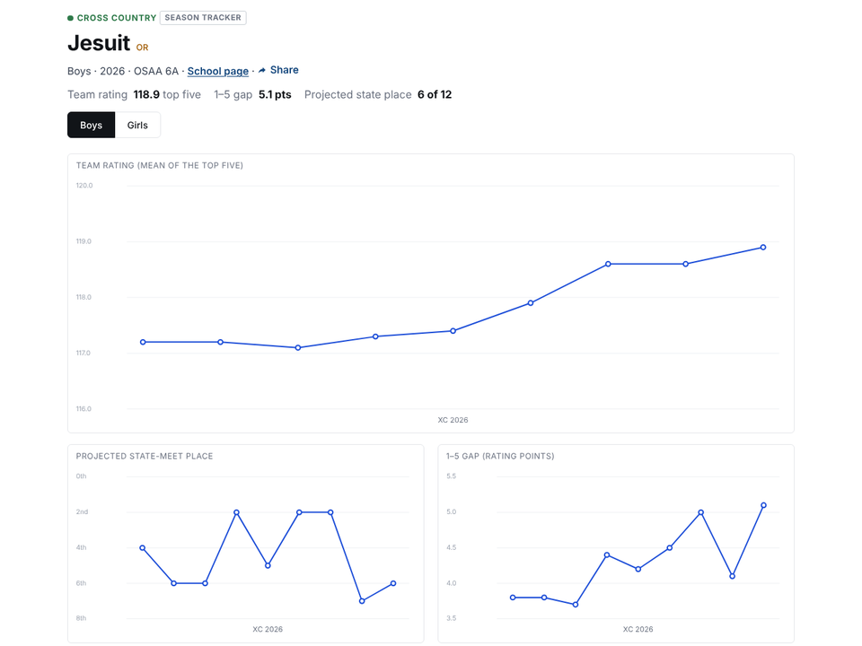
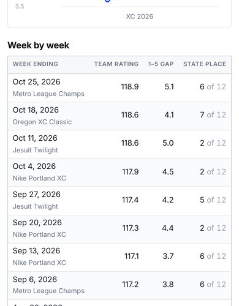
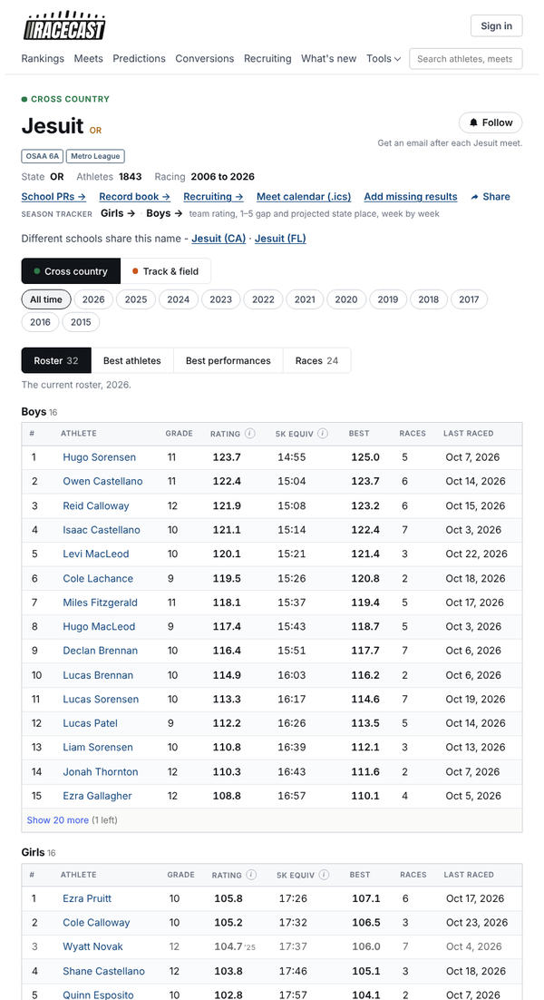
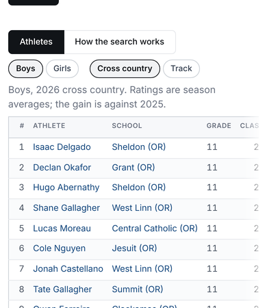
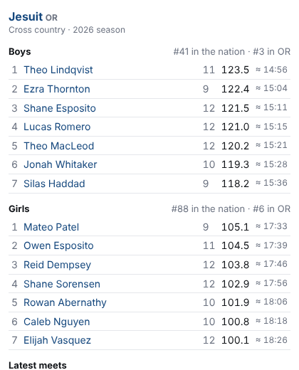

# Racecast for coaches: task walk-throughs (October 2026)

This is part of the October UX review. It covers HS and MS coaches and college recruiters, on desktop and on a phone on meet day. Each task was walked through the real templates, JS and routes with mocked data. Screenshots are in `ux-2026-10/coach-*.png`.

**In short:**
- **The strong tools are hidden.** A Best-seven lineup optimiser and a dual-meet scorer exist, but only as the third tab of Predictions results, after you run a whole prediction. A week-by-week team season tracker exists, but it sits behind one muted line.
- **The school page doesn't do what a coach comes for.** The roster has ratings only (no times, trend, varsity line or sorting). The Races tab shows "Average rating", not team place and score. The team's own rank isn't on the page, though the embed widget shows it.
- **Meet day is hard on a phone.** In a 200-runner race your 19 runners are spread over 12,500 px, and Team scores sits at 13,660 px.
- **Recruiters can't do the basics.** They can't save athletes or filter by track event, and recruit search has no CSV. "College shortlist" is a tool for athletes comparing colleges.
- **Track coaches get nothing for relays or field events, and no dual-meet scoring.**

---

## 1. See my roster's season at a glance

**Steps:** school page → Roster. For the week-by-week view, use the small "SEASON TRACKER Girls → Boys →" line in the header, which goes to `/school/<name>/season`.

- **The roster columns are #, Athlete, Grade, Rating, 5K equiv, Best, Races, Last raced:**
  - **No times.** No 5K PR, season best or last race time.
  - **No trend.** Who improved over the last 2–3 races? Who is slumping? The data exists, and `my_page` already draws movement arrows.
  - **No varsity line.** Nothing marks the scoring 5 or the top 7, the 5–7 gap, or the "next man up".
  - **No sorting.** The headers aren't clickable.
  - **"5K equiv" is a track 5K**, which a coach reads as a course time.
- **Rows past 15 are behind "Show 20 more (1 left)".** The 20 is hard-coded.
- **Boys and girls are stacked on one long page**, with no toggle and no grade filter.
- **The team's national and state rank isn't on the school page.** The embed shows "#41 in the nation · #3 in OR" (`app.py:7255-7287`).
- **The roster note is developer-worded**: "…until the team's third race or until they turn out for someone else…".

**The season tracker** (`team_season.html`, `team-season.js`) is the best coach feature on the site, and it's hidden:
- **Hard to reach.** It's linked only from a muted line in `_next_race.html:25-28`, and the Roster tab never points to it.
- **HS only** (`team_tracker.py:42`). MS and college coaches get nothing.
- **"Top seven" is a run-on list of names.** You can't see who moved in or out of the top 7, and on a phone the column is hidden entirely.
- **The projected-place chart's top axis label reads "0th"** (`team-season.js:47` `ordinal(-v)`).
- **The 1–5 gap chart rises as things get worse**, and it's in rating points, not seconds.
- **The footnote is model talk**: "the boards' own season rule (the 80th-percentile race, after dropping races far under their median)". The error state prints the exception name (`team_tracker.py:224`).

 

**Ideas:**
- **A "Team" first tab for coaches.** Each runner gets season best, last race and its change, and a sparkline of the last 5 races. Columns sort when you click the header. Lines under #5 ("scorers") and #7 ("varsity"), and the 1–5 gap in seconds.
- **Fold the tracker in as a "This season" tab**, for MS and college too. Show the top seven as a runners-by-weeks grid with coloured moves in and out.
- **The team's rank (nation, state, division) in the school header.**
- **A "who's trending" strip**: the biggest improvers and the biggest drops over the last 3 weeks (`breakouts.py`, filtered to one school).
- **A weekly coach digest** for claimed teams: new results, PRs, top-7 changes, and movement in projected state place (extend `follow_alerts.py`).

## 2. Pick a varsity 7; simulate rivals; try swaps

**What exists:** a real lineup optimiser and a dual-meet scorer.
- `/api/predict/lineup` (`app.py:11984`) runs a Monte Carlo search for the seven most likely to win, and correctly treats the 6th and 7th runners as displacers.
- `headToHead` (`predictions.js:3546`) scores dual meets.

**Steps to reach it:**
1. Predictions → pick a meet.
2. Set up the field (race pills, groupings, a team box per race).
3. Predict.
4. Open the third tab, "Dual meet · Best seven" (`predictions.js:3375`).
5. Pick the team → Find.

**Friction:**
- **Not reachable from the school page or the tracker.** The `/coaches` card doesn't mention it.
- **The API works without a meet** (`app.py:12011-12013`, "name at least one team"), but the page offers no way in without one.
- **No track dual meets (5-3-1 scoring)**, which are common in HS.
- **The answer is in model language**: "lineups raced", "(a swap search, not every combination)", "win chance cannot tell them apart" (`predictions.js:3746-3748`).

**Ideas:**
- **A "Pick my seven" button on the school page and the tracker.** Against [rivals] at [course] on [date] → recommended seven, win %, projected score, and the lineups close behind. Everything is already in the API response.
- **What-if swaps directly on the roster.** Tick 7 runners; the score and place against the named rivals update live.
- **Season-long planning**: "our best seven for state if the field is this year's qualifiers".
- **A track meet-entry optimiser**: with per-athlete event limits and an opponent, assign entries to maximise points. The scoring tables are in `tf_points.py`.

## 3. Scout a rival

- **The Races tab shows Runners / Average / Best rating** per meet. "Average", with JV included, means nothing to a coach. Show the team's place and score; published scores already exist.
- **No team-against-team view.** `/compare` handles athletes only.
- **The meet preview guesses the field** ("teams that ran the last edition, each with this season's top seven by rating"). A coach can't enter the real entries.
- **The meet finder caps results** at 25 for XC (`app.py:5284`) and 40 for track (`:5330`), so "every Jesuit runner at this meet" gets cut off at big meets.

**Ideas:**
- **Team compare** (`/compare?team=A&team=B`): both top-7s with times, both season ratings on one chart, shared meets with places and scores, and a projected dual-meet score.
- **A printable scouting report per rival.**

## 4. Meet day on a phone

- **Results are not live**: the data refreshes nightly.
  - The follow promise reads "Get an email after each Jesuit meet", while the setting says "the next morning" (`follows.py:56`).
  - Nothing tells a coach when to check back.
- **Your runners are scattered.** 19 lit rows span y = 742 → 13,231 px, and Team scores is at 13,660 px.
  - There is no "my team only" toggle.
  - Arriving with `?school=` neither filters the table nor opens the team popup.
- **The team popup** (each runner's place and points, plus the team score) opens only from the side card, which on a phone is at the bottom.
- **The meet page marks which divisions your school ran in**, but not how they did.

**Ideas:**
- **`?school=X` pins a "Jesuit in this race" card at the top**: team place and score, the 7 runners with times and places, PRs flagged, and a "Show only Jesuit" toggle.
- **"My team at this meet"**: every division, our runners and our places on one screen.
- **"Results usually appear by Sunday morning — email me when they're up."**
- **Later, live links from timing companies** (`docs/TIMING-COMPANIES.md`). Even "results posted, open on the timer's site" would help.

## 5. Export and print

**CSV exists for** XC and track races (`app.py:4756`, `:5911`), School PRs (`:7367`) and rankings (`:10195`, `:10281`).

**There is no CSV for:**
- the roster
- the tracker
- an athlete's full history
- a whole meet (all divisions)
- predictions or lineups
- recruit search
- follows
- the shortlist

**Print:**
- **Only two pages have print styles**: the one-page profile (`previews.css:74`) and the scale table (`tools.css:50`).
- **A printed roster includes the top bar, nav, year pills, Follow, only 15 rows and the "Show 20 more" button.** Only the open tab prints. The same happens on race pages and any staged table.

**Ideas:**
- **A site-wide print sheet**: hide the top bar, nav, tabs, "more" buttons, Share and Report, and show every hidden row. A few dozen lines of CSS.
- **CSV on the roster, athlete, meet, tracker, recruit search and predictions**, using `csv_export.py`.
- **A "team season export"**: every result by every rostered runner this season in one file. This is the one coaches would use every week.
- **A printable meet-day sheet**: varsity 7 and JV with PRs, season bests and goal splits for *this course*. Racecast knows each course's difficulty, so it can do this.

## 6. College recruiters

**Path:** `/coaches` → Recruit search. The nav's "Recruiting" goes to the athlete-side page.

- **Filters are a rating range and "Gain at least", not times.** Recruiters think "sub-15:30 5K", "sub-4:20 1600".
- **No track event filter.** There is one rating across all events, so you can't search 400 or 800 runners.
- **Key filters sit below the Search button** (Boys/Girls, XC/Track: `recruiting_search.html:83-89`).
- **Placeholders look like values**: Season "2026", "Gain at least +0".
- **Results show ratings only**: no PR times or main event, and both Grade and Class of. On a phone the rating columns are off-screen.
- **No way to save a recruit.**
  - "College shortlist" is for athletes comparing colleges.
  - The "Being built" tab on `/coaches` promises watchlists.
  - Follow already does part of this (a digest per athlete), but nothing says so.
- **No contact path.** It should be opt-in, because these are minors.
- **Compare takes two athletes; recruiters compare 3–6.**
- **10 sort options**, including four "Most improved" and three "(model)", with model talk in the tooltips (`recruiting_search.html:60-69`). The page also uses "programme", "corpus" and the "Being built 3" tab.

 

**Ideas:**
- **Search by time per event** ("5K < 15:30", "1600 < 4:20", "400 < 50.0"), converted to a rating behind the scenes.
- **PR times in the results**: 5K XC, 1600, 3200 and the main track event, with grad year and state.
- **A recruiter board** built on follows: named lists, private notes, a weekly digest when anyone races or PRs, and CSV export.
- **Compare up to 6 athletes.**
- **Opt-in contact**: a claimed athlete or parent turns on "College coaches may contact me".
- **Name pages for who they serve**: "College fit" for athletes, "Recruit search" for college coaches.

## 7. Put my team on the school website

- **The option is buried at the bottom of the school page**, just above "Report it" (`school.html:424-437`). It isn't on `/coaches` or in the account's "Teams you coach".
- **The snippet's `height="520"` is too short.** The widget's content is 686 px tall at 420 px wide, so the latest meets and the link sit behind an inner scrollbar. There is no auto-resize.
- **Options only by editing the URL** (`&theme=dark`). There are no switches for squad, sport, number of rows or times.
- **The widget has no column headers.** "123.5 ≈ 14:56" with no explanation, and the people reading a school website are parents.

**Ideas:**
- **An embed builder in the school header and on `/coaches`**: pick options, see a live preview, copy the snippet.
- **The widget reports its height** with `postMessage` so the frame resizes itself.
- **Labels**: "Season rating (≈ track 5K)", and the latest meet with the team's place.
- **More embeds**: the latest meet card, the tracker chart, team records.

## 8. Track coaches

- **Relays are left out of ratings and predictions** (`predict.py:4618`, `:4742`). There is no relay builder.
- **Track predictions score one event at a time.** There is no whole-meet team projection and no dual-meet scoring.
- **Field events are listed by mark only**: no rating, no conversions, no help with entries.
- **Conversions cover distance events only** (`app.py:1863`: "Sprints, hurdles, steeple and relays do not count").
- **On a phone, track pages hide division and wind.**

**Ideas:**
- **A relay picker** for the 4x4, 4x8 and DMR: legs, order, projected splits and an alternate.
- **An event-entry planner**: limits per athlete and the meet type → the entries that maximise points (`tf_points.py`).
- **A whole-meet team projection** against named opponents.
- **"What's this worth in another event"** on the athlete's track tab (1600 → 800, 3200 → 5K).

## 9. Coach identity

- **"Teams you coach" claims are unverified** (`accounts.py:29`). A claim gives a "Your teams" list and a team card on My page, but nothing coach-only.
- **No dashboard, no roster corrections** (`_suggest_fix.html` is for athletes only), and **no way to confirm the schedule.**
  - The `.ics` file is "this season's meets this team ran last time, posted again".
  - Confirmed entries would make predictions and previews much better.
- **Idea: verify coaches by school-domain email** (`accounts.py:15` notes that Google gives a verified school domain). A verified coach would get a **Coach dashboard** with:
  - the roster with trends
  - the lineup tool
  - an editable schedule that feeds predictions
  - a meet-day view
  - roster fixes as trusted corrections
  - CSV exports
  - the embed builder
  - the weekly digest

## Developer wording on coach pages

- `team_season.html`:
  - the error message shows `{{ data.error }}`, the exception name;
  - the footnote is the "80th-percentile race" rule.
- `coaches.html`: a "Being built 3" tab, "corpus", "programme".
- `recruiting_search.html:65-67`: sort tooltips such as "the network asked…" and "Favours the bottom of the range, because everybody at 80 is projected to gain more…".
- `predictions.js:3746-3748`: "lineups raced", "a swap search, not every combination".
- `school.html`:
  - "Meet calendar (.ics)";
  - the carried-roster note;
  - "Season tables are rebuilding. The roster and the year filter return when the rebuild finishes; everything below is live."
- `shortlist.html:60`: "(racecast/follows.py --init)".
