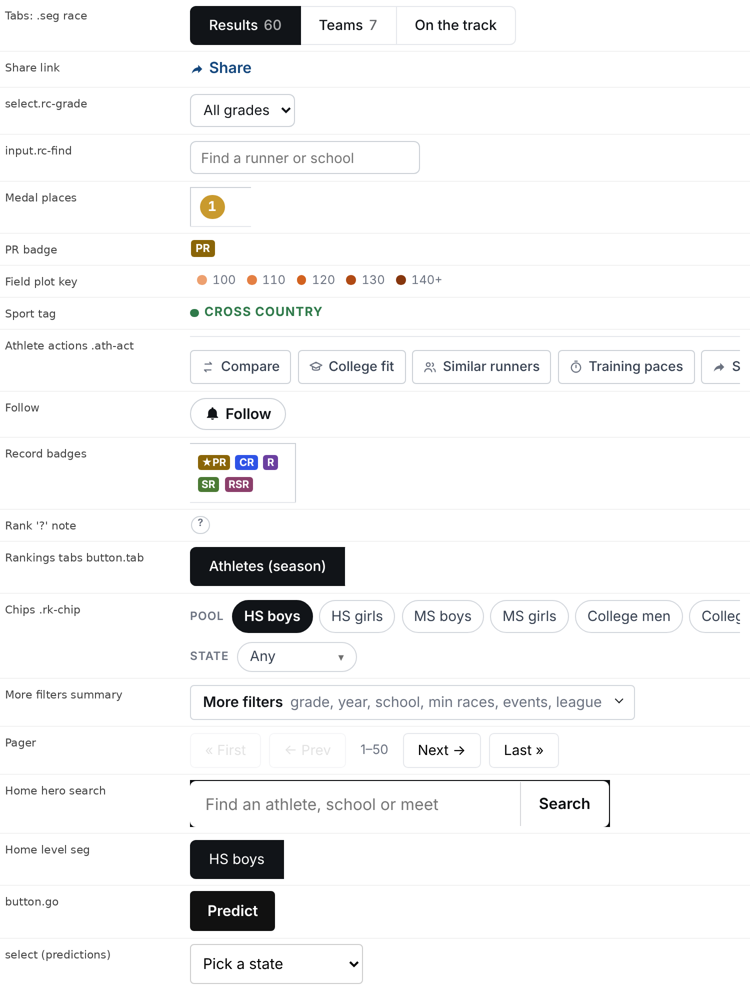
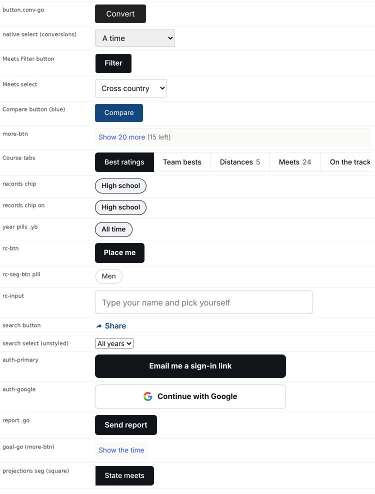
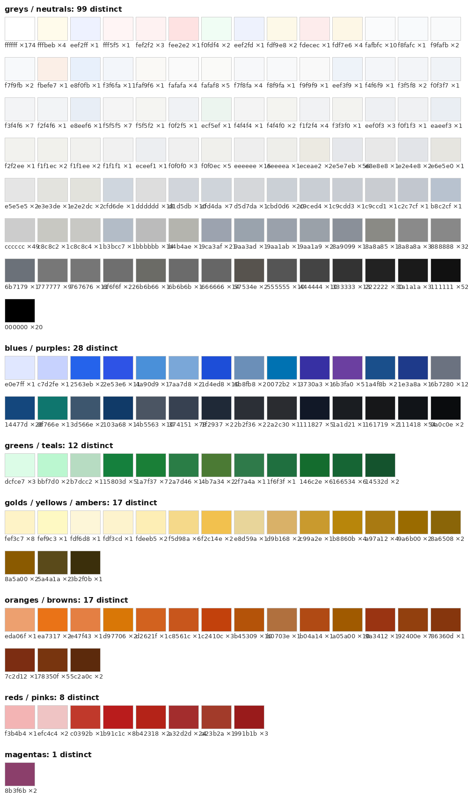
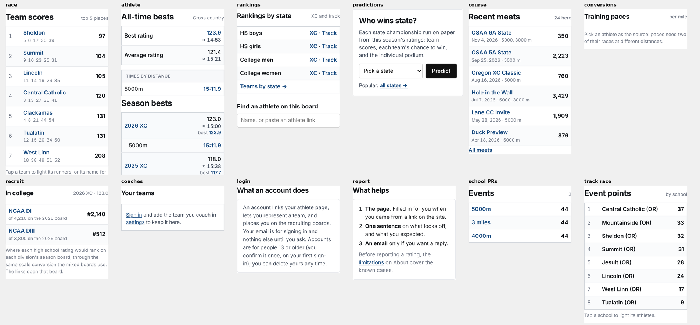
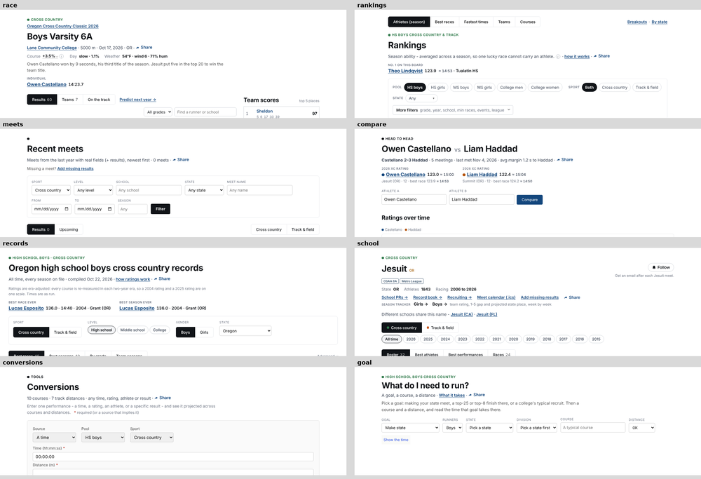

# Racecast visual design system: audit and proposal (October 2026)

This audit is part of the October UX review. It measured 29 rendered pages at 1280 px and 390 px (computed styles collected with Playwright) and parsed all 12 stylesheets in `racecast/static/`.

Screenshots:
- `ux-2026-10/design-controls-1.png` and `-2.png`: 37 control variants from 17 pages.
- `design-color-swatches.png`: 182 hex colors with use counts.
- `design-side-cards.png`: the side card on 12 pages.
- `design-page-headers.png`: the top of 8 pages.

**In one line:** the site has a few good shared rules (one tab spec, one chip spec, a token set), but they are mostly bypassed. So one job, such as "pick a level", "the main button" or "a side card", looks different on almost every page.

---

## 1. Typography
- **Font sizes**:
  - 770 declarations with **91 distinct values** (`0.85rem` and `.85rem`, `0.86rem`, `0.84rem`, `0.82rem`, `0.8125rem`…).
  - Rendered, that comes to **44 sizes on desktop and 45 on a phone**.
  - Some clusters sit 0.1–0.3 px apart and are indistinguishable: 10 / 10.4 / 10.5 / 10.8 / 10.88 px; 12.48 / 12.75 / 12.8 / 12.92 px; 13.44 / 13.5 / 13.6 / 13.76 px.
- **Weights**:
  - 400, 500, 600, 650 and 700 are rendered; 750 and 800 are declared too.
  - **650** (25 uses) only exists on a variable system font, so headings differ between Mac and Windows.
- **Line-heights and spacing**: 24 distinct line-heights and 18 distinct letter-spacings.
- **Uppercase micro-labels**: 65 uppercase declarations make **18 different label styles**, from 10.4–14.4 px, at weights 400–700, with letter-spacing from 0.33 to 1.02 px.
- **Headings** (desktop):
  - h1 comes in 4 sizes (30, 30.4, 32, 32.8 px).
  - **h2 comes in 7 sizes** (16.8 to 30.4 px). Home's h2 is 30.4 px, almost an h1.
  - h3 comes in 4 sizes.
  - Side-card titles are 21.6, 17.6 or 16.8 px, depending on the page.
- **Headings** (phone):
  - h1 is 19.6–26.6 px and h2 is 14.7–16.1 px, so the two levels are barely different.
  - **On home, h2 (22.4 px) is bigger than h1 (21 px).**
- **Small text on a phone**:
  - **11% of text nodes render under 11 px**; the smallest is 9.1 px.
  - The cause is the 14 px phone root multiplied by `.7rem`, `.72rem` and `.78rem` labels.
- **Font family**: one system stack (good), with a different stack hard-coded for tooltips (`style.css:4337`).

## 2. Color
- **Literals and tokens**:
  - There are **214 distinct color literals**.
  - **43 distinct text colors** render across the 29 pages.
  - Tokens are defined in 3 places (`style.css:3246`, `:5849`, `:5890`), plus private sets (`--rk-*`, `--eqc-*`, and `--tip` redefined 5 times).
  - **928 color literals against 262 `var()` uses** in `style.css`. The muted grey `#6b7280` alone is typed out 124 times across the stylesheets.
- **Three families of grey** (about 120 greys in all):
  - Cool slate: #6b7280, #374151 and friends.
  - Neutral: #111, #222, #333 … #f5f5f5.
  - Warm: #fafaf8, #f0f0ec, #8a8a85.
  - You can see them side by side: table headers are #f7f8fa on the race page but #f5f5f5 on search and conversions.
- **Gold carries at least eight meanings**:

  | Gold | Meaning | Where |
  |---|---|---|
  | #a97a12 | lit team | |
  | #c99a2e | 1st place | |
  | #8a6508 | PR badge | |
  | #a05a00 | tooltip border | |
  | #fdf3cd | arrival row | |
  | #fef9c3 | school highlight | |
  | #fdf7e6 | school highlight, race pages | |
  | #fdf6d8 + #b8860b | rankings found row | |
  | #fdeeb5 | row flash | |

  So 1st place, a PR, your team, the row you came for and a tooltip all look the same.
- **The same class is colored differently by file**:
  - `tr.row-hi` is gold globally (`style.css:4253`) and **blue** on race pages (`race.css:115`).
  - `tr.hl-school` is #fef9c3 in `style.css:4347` and #fdf7e6 in `race.css:113`.
- **Orange collides**:
  - The rating-tier ramp `--rt1..5` (`style.css:5891`) is the track color family. `--tf` against `--rt3` is **1.15:1**, effectively the same color.
  - So the XC race page's dot chart is drawn in the track color, right under a green "Cross country" tag.
  - `--rt1` on white is 2.13:1, below the 3:1 needed for graphics.
- **Green carries four meanings**: SR badge, XC tag, "above level", "easier" course. Plus three one-off greens.
- **Four blues**:
  - Link navy #14477d.
  - #2e53e6: course-PR badge, "Show 20 more", progress bars, predictions link-buttons.
  - #1d4ed8 and #2563eb.
  - Compare's button is the only filled colored button on the site.
- **Five reds**: #a32d2d, #b91c1c, #991b1b, `--harder` #b42318, #c0392b.
- **Contrast problems**:
  - **Link navy against body text is 1.96:1**, and 773 of 1,169 rendered links have no underline, so color alone has to carry them (WCAG needs 3:1).
  - White numerals on the gold and silver medals are about 2.6:1.
  - The track tag is 4.37:1 at 10.9 px.
  - #9ca3af text is 2.54:1 (21 uses); #888 is 3.54:1 (32 uses).
- **Badges**: PR, SR, CR, R and RSR are five saturated fills, plus a grey "out". At 24×17 px, R and RSR are told apart by letters alone.
- **No dark mode**:
  - No `prefers-color-scheme` anywhere, and `body` has no background set.
  - Only 2 `prefers-reduced-motion` rules for 16 animations and transitions. The 1.6 s row flash (`race.css:139`) has no fallback.
- **18 link styles**:
  - Navy and not underlined at weights 400, 600 and 650.
  - Navy and underlined at 400, 600 and 700.
  - Ink-colored links at 500–700, plus grey and white links.
  - Underlines appear on meta links but not on table names.

## 3. Components
- **66 distinct control looks** across 75 class combinations.
- **Primary buttons, 9 looks for one job**:

  | Class | Page | Look |
  |---|---|---|
  | `button.go` | predictions | #111, radius 4, height 40, weight 600 |
  | `.go` | report | #111418, radius 6 |
  | `.conv-go` | conversions | #222, height 37, weight **400** |
  | Filter button | meets | |
  | button | search | #222, weight 400 |
  | `.rc-btn` | recruiting | weight 650 |
  | `.auth-primary` | login | **radius 8, height 47** |
  | `.h2h-go` | compare | **navy fill** |
  | `.goal-go` | goal | **blue text on a tinted strip**: the page's main action looks like "show more" |

- **Secondary buttons, 6 looks.** `.rc-btn-quiet` renders filled black, the same as primary.
- **Inputs and selects**:
  - Borders: #ccc, #cbd0d6, #d1d5db.
  - Radius: 0, 3, 4, 6 or 8 px.
  - **Heights: 10 different values from 33 to 47 px.**
  - Native grey selects sit on rankings, conversions and report. Search has one **20 px tall at 13.33 px** (the browser default).
- **Tabs**:
  - The spec "ONE LOOK FOR TABS, ONE FOR CHIPS" (`style.css:5719-5785`) exists.
  - Projections and state odds render **square tabs**; home renders weight 400.
  - The "Advanced" scale toggle is styled as a tab, so a setting looks like navigation.
  - **Rankings puts its tabs above the h1**; every other page puts them under the header.
  - Overflowing tabs clip ("Co", "On t") with no fade.
- **Chips**:
  - `race.css:543` overrides the chip spec to a **black fill**, so the rankings chips look like tabs while the records and recruiting chips look like chips.
  - `.yb.is-on` is defined twice. `.unit-btn` is a 15 px-tall chip of its own.
- **One job, different controls on every page**:
  - **Choosing a level**: chips (rankings), tabs (home), outlined chips (records), a select (meets), a select labelled "Pool" (conversions), pills (recruiting).
  - **Choosing a sport**: chips, a select *and* tabs (meets), dotted tabs, tabs inside the filter box, top-level tabs.
  - **The records filter box uses four control types at once.**
- **Apply behavior**: rankings and records apply instantly; meets and recruiting need a button.
- **5 ways to show "selected"**: black fill, grey fill with an outline, an underline, **greyed-out text** (predictions shows selected items in #888) and a gold row rule.
- **4 help glyphs**:
  - "i": a link next to Rating, a tooltip next to Difficulty.
  - "?"
  - "✱"
  - "⌄", which looks like a dropdown but opens a tooltip.
- **4 chevron implementations** and 14 rules that hide or restyle them.
- **Icons**:
  - 51 inline SVGs pasted by hand.
  - The share arrow is pasted into about 15 templates; `_share.html` exists but is unused.
  - Stroke icons and filled icons are mixed.
  - "→" appears 78 times as text.
- **Tables**:
  - **Two global `thead th` rules disagree** (`style.css:193` vs `:3339`); the first shows through on conversions and search.
  - 189 selectors touch `th`, 266 touch `table` and 297 touch `td`, across 10 files.
  - Header text ranges from 11 px to **14.4 px uppercase on conversions**, louder than the body text.
  - There are 7 header padding pairs, and row heights differ between pages.
- **Side cards come in 4 treatments**:
  - a bordered list-table (race, athlete, rankings, course, school PRs, track race);
  - a padded box (predictions, **300 px** wide where the rest are 280; login, report, coaches);
  - bare text (conversions);
  - sticky (school PRs only).

  Titles are 21.6, 17.6 or 16.8 px. Team names are ink on the track page and navy links on the XC page.

- **Page headers**:
  - The kicker above the h1 does four jobs: sport, section, a filter summary, or **nothing** (a lone dot on /meets).
  - Track pages say "Track & field" on the race page and "Outdoor track" on the meet page.
  - The h1 sits anywhere from y = 98 to 206 px.
  - Share sits in 4 different places.

- **Footers**:
  - "Report it" is on only **7 templates**; it's missing on course, rankings, records, school PRs, compare and conversions.
  - CSV is on 4 pages, worded two ways.
  - Empty states use 7 different classes and 3 voices.

## 4. Spacing and layout
- **73 spacing values** with no scale, and 22 border radii.
- **Three left edges at 1280 px**: 100 px (most pages), **124 px on rankings** (an extra inset, `style.css` ≈5474), and 32–44 px on records and home (full-bleed).
- **Gutters**: the phone gutter is 12 px, but 14 px on predictions and 28 px inside the home hero.
- **Topbar**: 62 px on desktop, **99 px on a phone**. That is 12% of an iPhone screen on every page.
- **18 breakpoints**:
  - **700 vs 760 is a real gap.** `layout.js` and `style.css` switch at 700; `race.css` switches at 760.
  - Between 701 and 760 px, race-family pages get the stacked phone grid without the table boxes or the phone type size. Landscape phones and small tablets land here.

## 5. Why it drifts: the CSS architecture
- **Size**: 12 stylesheets, 3,114 rule blocks and 3,528 selectors. `style.css` is 5,976 lines, 40% of them comments.
- **`race.css` acts as a second global stylesheet.**
  - It loads on almost every page and holds rules scoped to unrelated pages (`.pred-page`, `.rankings-page`, `.home-rc`, `.recruit-*`, `.ath-page`).
  - Because those rules are more specific, they beat the shared components. For example, `race.css:543` beats the chip spec.
- **96 selectors have 5–7 parts**, e.g. `main.rc.pred-page .step[data-step="meet"]:has(#meet-search.hidden) .pred-rerun-h` (`race.css:868`).
- **Re-skin layers stack instead of replacing.**
  - The 10-05 tabs/chips layer and the 10-03 phone layer sit on top of older rules that were never deleted.
  - The old rules show through wherever a page-scoped rule doesn't match: projections' square tabs, conversions' 14.4 px headers.
- **A 297-line block is duplicated word for word**: `style.css:2111-2407` and `style.css:2464-2760` (the predictions section). An edit to one copy is silently undone by the other.
- **13 uses of `!important`.** Two are global: `style.css:5639` (16 px phone inputs, which is right) and `:5935`.
- **Tokens are bypassed**, so changing a token updates only about a fifth of the places it should.

---

## 6. Proposed system

**Type: 6 sizes, 3 weights (400, 600, 700)**
- Keep a 16 px root on phones as well, and shrink only table cells.
- **Nothing under 12 px.**

| Token | Desktop | Phone | Used for |
|---|---|---|---|
| `--fs-display` | 30 / 1.15 / 700 | 24 | h1 |
| `--fs-title` | 22 / 1.2 / 700 | 19 | h2, side-card titles |
| `--fs-subtitle` | 17 / 1.3 / 600 | 16 | h3, season headings |
| `--fs-body` | 15 / 1.5 / 400 | 15 | text, meta |
| `--fs-table` | 14 / 1.35 | 13.5 | cells, buttons, inputs (16 on phone inputs) |
| `--fs-label` | 12 / 1.3 / 600, sentence case, muted | 12 | headers, kickers, stat labels |

**Color: about 20 tokens; every literal maps to one**
- **Neutrals** (one cool family): `--ink` #111418, `--ink-2` #374151, `--muted` #6b7280, `--faint` #9ca3af (borders and icons only, never text), `--line` #e5e7eb, `--line-2` #cbd0d6, `--surface` #fff, `--surface-2` #f7f8fa, `--hover` #f3f6fa.
- **Links**: `--link` #14477d, **underlined** in prose and meta lines; names in tables may stay bare. `--focus` is a 2 px ring.
- **Sport**: `--xc` #2f7a4a and `--tf` #c8561c, and **nothing else orange**.
- **Rating tiers**: move the ramp to **navy** (#c7d6ea → #14477d → #0b2747), with the lightest step at least 3:1 on white.
- **Medals**: keep the colors, but make the numerals `--ink`.
- **One highlight**: `--hl-bg` #fdf3cd with a `--gold` rule, used for every lit, arrival, found and flash row. Delete the blue `row-hi` and the other five golds.
- **Status**: `--positive` #1a7f37, `--negative` #b42318, `--warn-bg` / `--warn-fg`. Delete the other reds.
- **Badges**: PR is an ink fill and SR an ink outline. The others leave the default view, or become muted outlines.

**Buttons: 3 styles in 2 sizes (40 / 32 px), radius 6**
- **Primary**: ink fill, white text, weight 600.
- **Secondary**: white with a `--line-2` border.
- **Quiet**: `--link` text with no box, used for show more, all teams, and Share.
- **Share** is a quiet icon-plus-label button at the right end of the title row.

**Fields**: 40 px tall (44 on a phone), `--line-2` border, radius 6, a custom select caret, and no native grey selects.

**Tabs**:
- The existing tab spec is the only tab.
- It always sits under the page header.
- When tabs overflow, they wrap or scroll with the same fade the tables use.
- The scale toggle becomes a switch, not a tab.

**Chips**:
- The existing chip spec everywhere, rankings included (drop `race.css:543`).
- Rules of use:
  - narrowing a list → chips (or one select on a phone when there are more than 5 options);
  - choosing what the page shows → tabs;
  - long lists (state, year) → a select.
- Filters always apply instantly.

**One table**:
- Header in `--fs-label` on `--surface-2` with a `--line-2` rule.
- Cells padded 8/10, numbers tabular and right-aligned, the place column 2.5 rem.
- Highlight rows use `--hl-*`.
- One rule in one file; delete `style.css:193`.

**Side card**:
- 280 px wide, a `--fs-title` heading with an optional muted label.
- The body is a list-table or a padded box, never bare text.
- Sticky everywhere or nowhere.
- Folds to the top as `
` on phones.

**Page header**, at the same height on every page:
1. Sport kicker, or nothing.
2. h1.
3. Meta line.
4. Facts row (optional).
5. Actions row with Follow and Share on the right.
6. Tabs.

**Partials**: one footer ("Report it" plus CSV) on every data page; one empty state (a muted sentence plus a next step).

**Scales**:
- Spacing: 4, 8, 12, 16, 24, 32 and 48 px.
- Radius: 6, 999 and 50%.
- **One phone breakpoint**, used by `layout.js`, `style.css` and `race.css` alike.

**Icons**:
- One 24 px stroke set, with the share arrow redrawn to match.
- `_share.html` everywhere.
- One help glyph ("i") that always opens the bottom sheet and never navigates.

### What maps to what
| Today | Becomes |
|---|---|
| `button.go`, `.go`, `.conv-go`, meets Filter, search button, `.rc-btn`, `.rc-btn-quiet`, `.auth-primary`, `.h2h-go`, `.goal-go` | **Primary** |
| `.ath-act`, `.auth-google`, pager buttons, `.rc-follow`, `.yb-more` | **Secondary** |
| `.more-btn`, `.rc-more`, `.rc-out`, `.pool-more`, `.share-btn`/`.rc-share-link`, `.combo-done` | **Quiet** |
| `.seg-btn`, `button.tab`, `.board-strip a`, `.toggle-group button`, `.sport-toggle a`, `.search-tab` | **Tab** |
| `.scale-toggle` | **Switch** |
| `.rk-chip`, `.pool-chips .chip`, records `a.chip`, `.rc-seg-btn`, `.yb`, `.unit-btn`, `.race-chip` | **Chip** |
| native selects, `.combo-btn`, `.rc-input`, `.rc-find`, `.rc-grade` | **Field** |
| `thead th` (both), `.rc-table`, `.rk`, `.conv-table`, `.hm-t`, `.rc-tscores`, `.ath-bests`, `.scale-tbl` | **Table** (`.rc-tscores` stays as the card variant) |
| `.rc-side` variants, `.pred-state`, login/report/coaches boxes, conversions' bare text, `.rc-side-sticky` | **Side card** |
| `.flag--pr`, `.flag--sr` | **PR / SR badges** |
| `.flag--cpr`, `.flag--rpr`, `.flag--rsr`, `.flag--out` | tooltip text or a muted outline |
| `tr.row-hi` (both), `tr.hl-school` (both), `tr.rc-lit`, `tr.is-found`, `tr.rc-flash` | **`--hl-*`** |
| `.info-i`, `.rank-note`, `.season-note`, `.dv-tick` | **One "i" + bottom sheet** |
| `mp-empty`, `rb-empty`, `rp-empty`, `empty`, `board-empty`, bare `.meta` | **Empty-state partial** |
| `.page-report`, `.csv-link`, rankings CSV line | **Footer partial** |
| `--rk-*`, `--eqc-*`, `--tip` ×5 | **Global tokens** |

### Housekeeping that makes it stick
- Delete the duplicated `style.css:2464-2760`.
- Move page-scoped rules out of `race.css`, or rename it `pages.css`.
- Replace the 124 hand-typed `#6b7280` and the other literals with tokens.
- Unify the 700/760 breakpoint.
- Delete `style.css:193`.
- Strip comments at deploy.
