# Racecast UX review: October 2026

This review is written for the people who use the site: runners (MS, HS, college), their parents and coaches, and most of them are on a phone. It is not a code review.

**How I looked.** I rendered the real templates locally with made-up sample data (one 60-runner race, one runner with two XC seasons and one track season, a 50-row rankings board) and took screenshots in Chromium at 390 px (iPhone 13) and 1280 px. I did not use the live site, and I did not have Safari/WebKit. Names and numbers in the shots are fake. The course page and the recruiting pages are reviewed from their templates only. Screenshots are in `docs/ux-2026-10/`. In the mockups, the parts I changed have a dashed blue outline.

---

## The biggest problems, in order

### 1. On a phone, the results start a full screen or more down the page

"Results first" holds on desktop, but not on a phone. Before the first result row, a phone user scrolls past:

| Page | Before the first row | First row starts at |
|---|---|---|
| Race | meet link, sport tag, title, meta, Share on its own line, course/day/weather, story, **a winner block that repeats row 1**, tabs, "Predict next year", grade picker, find box, dot chart | ~720 px (screen 2) |
| Rankings | 5 tabs (the 5th is cut off), Breakouts · By state, title, subtitle, No. 1 line, filter panel (Pool, Sport, State, More filters), **a second search box** | ~790 px |
| Athlete | name, Follow plus 2 lines of help text, 4 stats, ranks, 5 buttons, the recruiting line, tabs, **an open chart** | ~900 px |

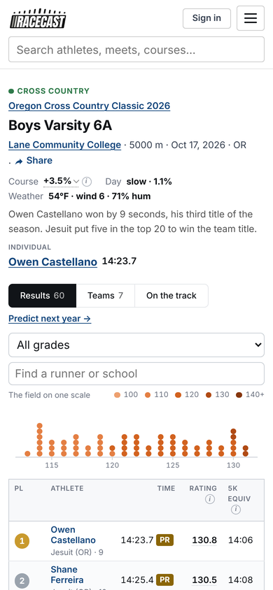 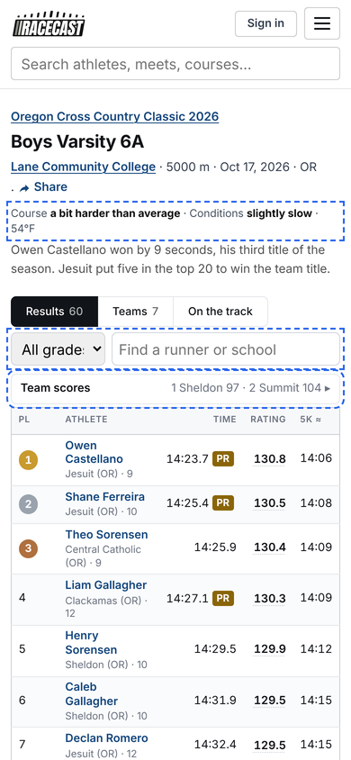

*Race page on a phone: as built (left), mockup (right). In the mockup the duplicate winner block is gone, course and day are in plain words, the grade picker and find box share one row, team scores are folded above the table, and the dot chart moves under the table. The first runner now appears on the first screen.*

### 2. Athlete page on a phone: the rating is off-screen and the PRs are at the very bottom

- The season table has 8 columns and a 640 px minimum width, so on a phone you see Date, Meet, Result and Place. **Rating, the number the site exists for, is off the right edge.** The only hint is a faint fade.
- **"All-time bests" and "Season bests" come after every race and after "Report it".** PRs are what a parent looks for first. `layout.js` has code that folds the sidebar into a "Bests & PRs" bar at the top, but it looks for `.page-layout`, which no template uses anymore, so that code never runs (a silent regression).
- The race page's Team scores card has the same problem. On a phone it sits under all 60 rows (under 250 at a big meet), and its tip says "Tap a team to light its runners", but those runners are thousands of pixels further up.

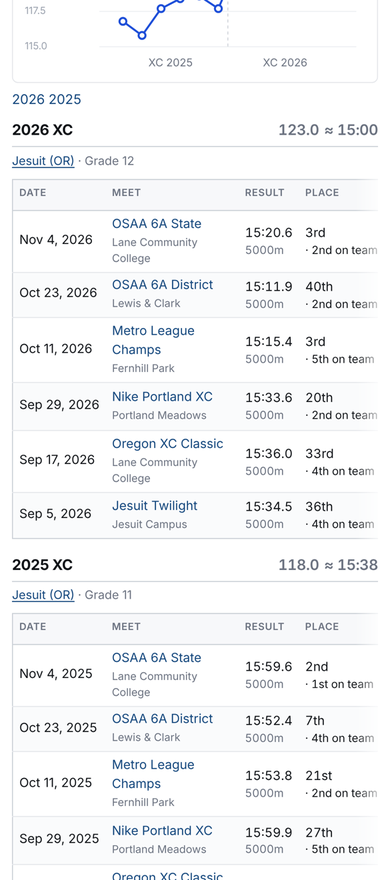 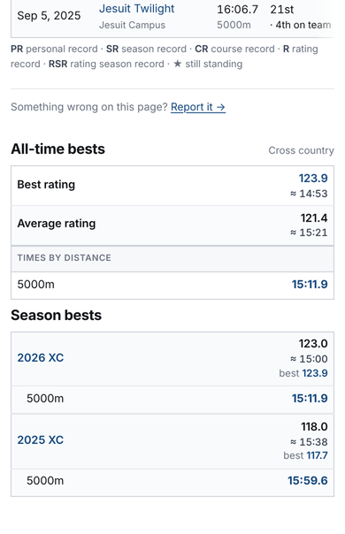 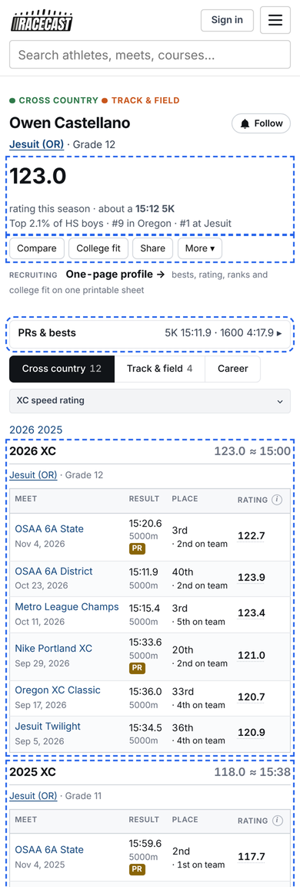

*Left: Rating is off the right edge. Middle: the bests come last. Right: mockup with one headline number and sentence, 4 buttons, "PRs & bests" folded at the top, the chart folded, and a season table of Meet (date under it), Result, Place and Rating that fits the screen.*

### 3. Too many numbers and badges for one runner

A parent opening an athlete page sees **seven different numbers that look like "the" rating or time**:

- Athlete rating 123.0, with ≈ 15:12
- Best race 123.9, with ≈ 14:53
- The season heading's 123.0 ≈ 15:00
- The sidebar's Best rating and Average rating, each with a ≈ time
- The Rating column and the 5K equiv column on every row

Next to those there are **five record badges** (PR, SR, CR, R, RSR, plus a ★), a "Course +4.2%⌄" cell on every row, and three ranks. Each one makes sense on its own. Together, nobody can tell which number matters.

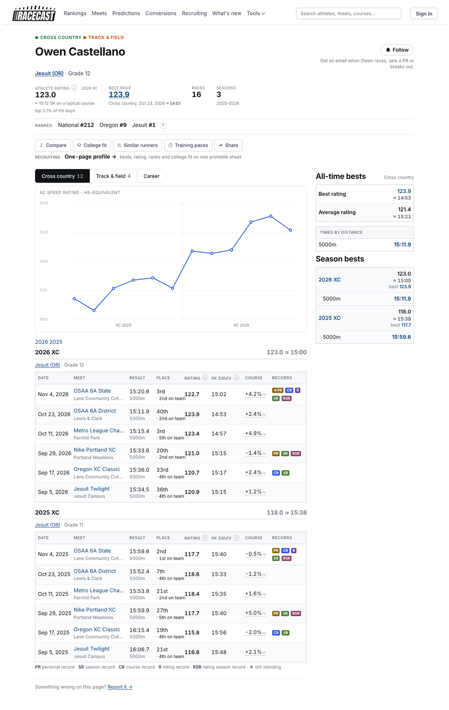

### 4. Jargon that only the builder knows

| On the site | Where | What a parent reads | Suggest |
|---|---|---|---|
| **Pool** | rankings filter, conversions | ? | **Level** (HS boys, MS girls…) |
| **Course +3.5%⌄** | race header, every athlete row | "3.5% of what?" | "Course: **harder than average**". Keep the % in the tooltip. |
| **Day slow · 1.1%** | race header | ? | "Conditions: **slightly slow**" |
| **Compiled** | meet page tab and stat | ? | **Combined results** (all runners at a distance in one list) |
| **XC SPEED RATING - HS-EQUIVALENT** | athlete chart title | "equivalent to what?" | **Speed rating**. There is only one public scale now, so the qualifier says nothing. |
| **5K EQUIV ⓘ** (wraps to 3 lines on a phone) | every table | OK once explained | **5K ≈** on one line |
| **R, RSR** ("Rating Season Record") | athlete rows | ? | Show **PR** and **SR** only. Keep R/RSR/CR in the tooltip, or behind a "more badges" setting. |
| **Source / Pool / Sport / hh:mm:ss / Distance (m)** | conversions form | a spreadsheet | "I ran ___ for ___ on ___ → here's what it's worth" |
| "Meets from the last year with real fields (+ results)"; "no meet in the window cleared the results floor" | meets list | ? | "Recent meets, newest first"; "No meets match these filters." |
| "Season ability - averaged across a season…" | rankings subtitle | OK, but long | "Each runner's average rating this season." |

The best explanation on the whole site is the home page's one sentence: *"100 is an average high schooler, about a [time] 5K."* It should be the first line of the rating ⓘ on every page. Right now the ⓘ next to "Rating" is a **link** to /scale, so on a phone a tap may take you away from the page instead of showing the tip.

### 5. One thing, several names; one control, two copies

- **Compare**: "Compare" (athlete button), "Compare two athletes" (Tools menu), "Head to head" (the page's own title).
- **Recruiting**: "Recruiting" (nav), "College fit" (athlete button), "Where would I fit in college" (home), "Similar runners", "RECRUITING · One-page profile" (athlete header), "Recruit search" (/coaches). That is six names for one family of features.
- **Two search boxes on one screen**: on rankings ("Find an athlete on this board" under the site search) and on home on a phone (the top bar and the hero box).
- **Meets list**: a Sport dropdown *and* Cross country / Track & field tabs under it.
- **Side cards** go to the bottom on a phone on both race and athlete pages, against the rule that side cards behave the same everywhere and stay useful.

---

## The iPhone "table cut off at the top" bug

I could not run Safari, but I reproduced **a top clip that matches the description in Chromium too**. Every tooltip (`.flag::after`) opens **above** the element it belongs to. On a phone every table sits in `div.tscroll`, which has `overflow-y: hidden`. Anything in the header row (the Rating ⓘ, the 5K ⓘ) or in the first data row (a PR badge, the gold medal) therefore has its tooltip cut off at the top edge of the table box:

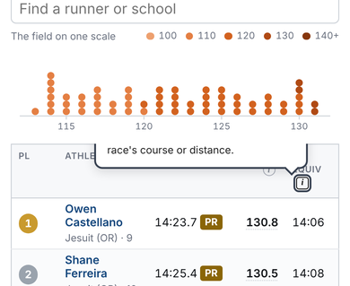

That may not be the bug in your screenshot. If yours shows the header row or the first runners missing *without* a tooltip open, the next suspects are:

1. the `-webkit-mask-image` that `.tscroll.has-more` puts on a scrolling box (WebKit has had painting bugs with masks on overflow containers); test by turning the mask off;
2. `width: 0; min-width: 100%` on `.tscroll` inside the CSS grid of `.rc-grid`.

**Please send the screenshot.** Whichever cause it turns out to be, the tooltip clip is real and worth fixing. On phones, show a tooltip as one popup attached to `<body>` (fixed at the bottom of the screen), not as a `::after` inside the table.

---

## Page by page

### Race (`race.html`)
- **Phone**: see problem 1. The winner block repeats row 1. "Predict next year →" sits between the tabs and the table, where it reads like part of the table. Share drops to its own line with a stray "·". Course and Day are jargon (problem 4).
- **Rows** are 3 to 4 lines tall on a phone ("Owen / Castellano / Jesuit (OR) · / 9"), because the PR badge widens the Time column. Under your rule ("one row, or made for two"), two lines is right: name on line 1, school · grade on line 2. That needs the PR badge to be a small mark after the time, or to go under it.
- **The dot chart** ("The field on one scale") is nice, but on a phone it costs about 250 px above the table. Put it under the table, folded.
- **Team scores**: tapping a team on desktop lights its runners, which is clever but hidden. On a phone the card is at the bottom (problem 2).
- **Desktop**: good. This is the strongest page.

### Athlete (`athlete.html`)
- See problems 2 and 3.
- The **Follow** help text ("Get an email when Owen races, sets a PR or breaks out.") takes two lines on a phone. Make it the button's tooltip, or show it only after the first tap.
- **Five action buttons, then a "RECRUITING · One-page profile" line** (from `_next_race.html`). Keep Compare, College fit and Share, and put the rest under "More".
- **The chart opens by default** above the races. On a phone it is a whole screen. Fold it on phones.
- **Meet names are cut off on desktop** ("Metro League Cha…", "Lane Community Coll…") while Place and Records have spare room.
- "2026 2025" season-jump links float alone above the first season. Fold them into the season headings, or drop them.
- **Desktop**: the place cell's "· 2nd on team" runs into the rating ("2nd on team122.7") at some widths.

### Rankings (`rankings.html`, `rankings.js`)
- **Phone**: see problem 1. The 5 tabs scroll sideways, and "Courses" is cut to "Co" with no hint that there is more. The filter panel is about 450 px tall.
- **"Athletes (season)" vs "Best races" vs "Fastest times"**: the difference is not obvious. Suggested names: "Top runners this season", "Best single races", "Fastest times".
- **Desktop**: 10 columns next to a 280 px side card, so school names wrap to 2 or 3 lines ("Mountainside / HS / TX") and "RACES" is cut off. **Sport and Year repeat the filter** on every row (always "XC", always "2026-27"). Hide them when the filter fixes them.
- **Phone table**: Rating and 5K are right after the name, which is good. School is off-screen. Put it under the name, as on the race page.

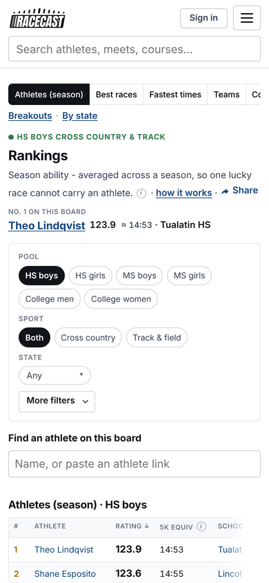 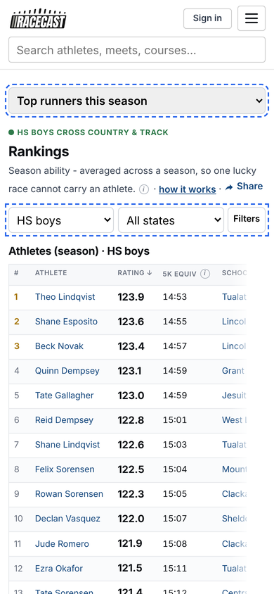

*Mockup: the tabs become one picker, the filters become one row (Level, State, Filters), and the second search and the No. 1 line are gone. The board starts on the first screen.*

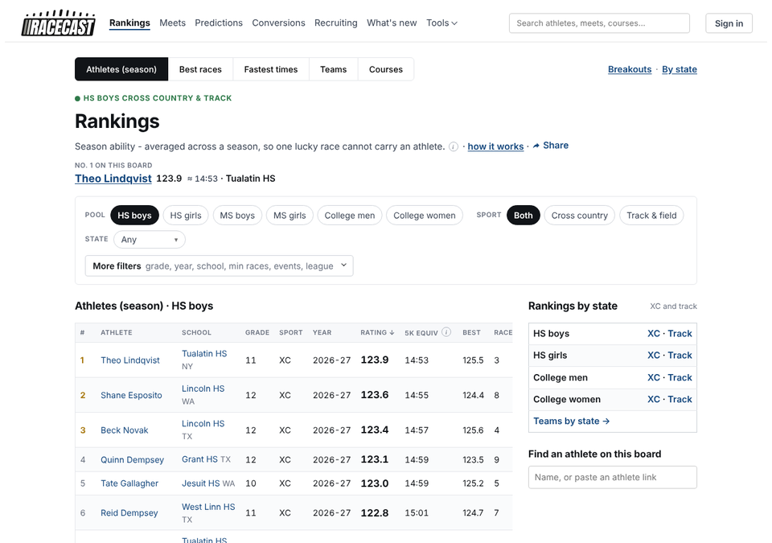

### Meet (`meet.html`): **the model to copy**
One header, one tab bar, one table, every row in the same two-line shape, no side card. The only fix needed is **"Compiled" → "Combined results"**. Race, athlete and rankings should feel like this on a phone.

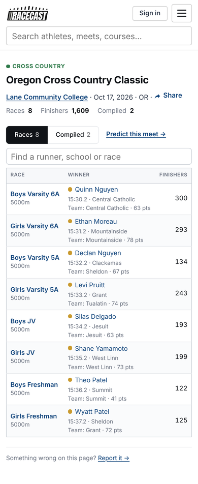

### Course (`course.html`, from the template)
- It has **up to 7 tabs**: Records, Team records, Best ratings, Year by year, Record history, Meets, On the track. Below them are distance pills. On a phone that is a sideways-scrolling bar where half the tabs can't be seen. Keep **Records · Best ratings · Meets**, and put the rest under "More".
- **"Difficulty +3.5%"** is the course page's whole point, and it needs words: "Runs **about 20 seconds slower** than an average 5K course." `difficulty_words()` already writes that sentence, so put it in the header.

### Home (`home.html`)
- Good: the hero sentence that explains ratings, and the four "Look up a runner / Predict / Convert / College fit" cards.
- **Phone**: there are two search boxes on the first screen. Hide the top bar's box on the home page, or drop the hero box on phones. The photo strip takes the top 300 px, so the search sits below it. Put the search first.
- "Share" drops to its own line with a stray "·" (the same on race and meet). Make Share a small icon button on the right of the title line.

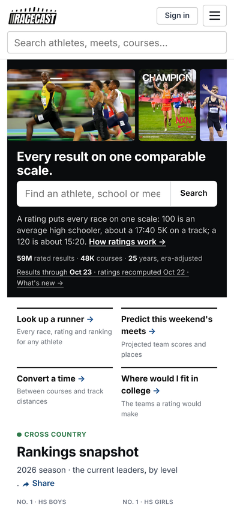

### Predictions (`predictions.html`)
This opening is clear: this week's meets, Who wins state, Re-run a past race. Keep it. The one confusing line is "or test the model against what happened"; drop it.

### Conversions (`conversions.html`)
The most common question a parent or runner brings here is "what is my 5K worth at another distance or course?" The page answers it with a form: Source / Pool / Sport / Time (hh:mm:ss, starting at 00:00:00) / Distance (m) / Course / Weather / Convert. Under the form are an empty table and an "Advanced" switch. Suggest one sentence with blanks: **"I ran [16:05] for [5K] at [course, optional] → 1600 ≈ 4:38 · 3200 ≈ 10:05 · on a flat course ≈ 15:48"**, with level and sport guessed from the athlete or a default. The subtitle "0 courses · 0 track distances · any time…" reads like a bug.

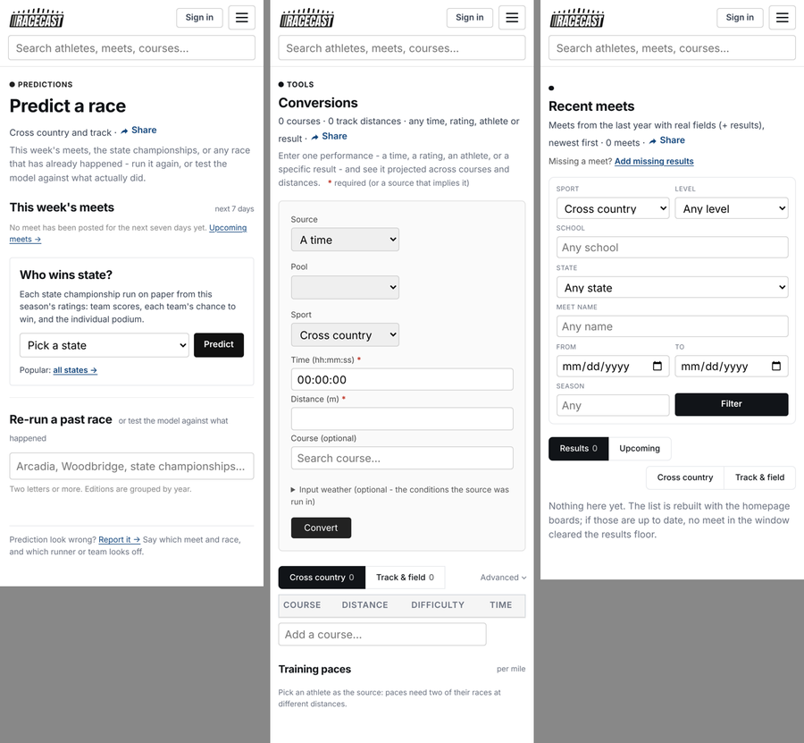

### Meets list (`meets.html`)
On a phone, 7 filter fields (Sport, Level, School, State, Meet name, From, To, Season) and a Filter button come before any meet. Then Results/Upcoming tabs and Cross country/Track & field tabs repeat the Sport dropdown. Suggest: the tabs, a search box, and "Filters ▸" folded.

### What's new, Compare, Uploads, Report, Contact
- **What's new**: the meta line ends in the link "when results show up", which reads like a fragment. Suggest "When do new results appear?"
- **Compare** is titled "Head to head". The two boxes have no placeholder, and the Compare button sits beside box B only. Title it "Compare", and use the site's dark buttons rather than blue.
- **Uploads/Report/Contact**: fine. "Add missing results" is in the Tools menu and on the meets list, which is good.

### Navigation (`_topbar.html`)
- There are 6 links plus Tools. **What's new** in the main bar matters to you, but for a parent it competes with the four things they actually do (find a runner, see a race, rankings, predictions). It could sit under Tools, with its dot kept on the Tools button.
- The Tools menu holds 8 tools + 4 reference links, and some names don't match the page titles (problem 5).

---

## Ranked plan

Effort: S = under half a day, M = 1 to 2 days, L = more. Risk: chance of breaking something you have already decided, or of breaking the site.

| # | Change | Helps | Effort | Risk |
|---|---|---|---|---|
| 1 | **Side cards fold to the top on phones, the same on every page**: "PRs & bests ▸" on athlete, "Team scores ▸" on race. Fix the dead `foldSidebar` in `layout.js` so it targets `.rc-side`. | parents, runners, coaches | S | Low |
| 2 | **Tooltips as one body-level popup on phones** (fixes the clipped ⓘ and PR tips; likely the iPhone top-clip) | everyone on a phone | S–M | Low |
| 3 | **Athlete season table fits a phone**: Meet (date under), Result, Place, Rating. On phones, Course and Records move into the row's tap-through, and the 5K goes under the rating. | parents, runners | M | Medium: it reverses the 2026-10-10 "5K kept on phones" note |
| 4 | **Race page phone order**: drop the duplicate winner block, grade + find on one row, dot chart under the table (folded), "Predict next year" after the table | runners, parents | S | Low |
| 5 | **Plain-words pass** (the table in problem 4): Level, Combined results, Course/Conditions in words, "5K ≈", chart title, PR/SR-only badges by default, meets-list copy | parents especially | S | Low (a few tests pin strings; update them) |
| 6 | **Athlete header: one number, one sentence**: "123.0 this season, about a 15:12 5K · top 2.1% of HS boys · #9 in Oregon", 3 buttons + More, chart folded on phones | parents | M | Low–medium |
| 7 | **Rankings phone filters in one row** (Level ▾, State ▾, Filters), the board picker as one select, drop the second search box | everyone on rankings | M | Medium: `rankings.js` is large and owns the URL state |
| 8 | **One name per feature**: Compare (not Head to head); College fit; Tools labels match page titles | everyone | S | Low |
| 9 | **Rankings desktop**: hide Sport/Year when the filter fixes them; school on one line | coaches | S | Low |
| 10 | **Meets list**: filters folded, the duplicate sport control removed | parents, coaches | S | Low |
| 11 | **Course page**: 3 tabs + More; difficulty in words in the header | runners | M | Low |
| 12 | **Conversions as a sentence** | runners, parents | L | Medium |

**I suggest doing 1–5 first.** They are small, mostly CSS and template text, and together they fix most of what a parent on a phone runs into. 6–8 come next. 11–12 are their own projects.

**I would leave these alone**: the meet page, the predictions opening, the home page's explanation and its four cards, the race page on desktop, and the one-scale decision.
