# Racecast UX review: October 2026

This review covers how the site works for the people who use it: runners (MS, HS, college), their parents and coaches, most of them on phones. It is not a code review. It lists everything found, grouped by area, and is not ranked.

**Companion files:**

| File | What's in it |
|---|---|
| [REVIEW-UX-2026-10-IDEAS.md](REVIEW-UX-2026-10-IDEAS.md) | what the site could become: research on other sites, 19 bigger ideas, a proposed site map, which pages to merge |
| [REVIEW-UX-2026-10-PARENTS.md](REVIEW-UX-2026-10-PARENTS.md) | 15 parent and runner tasks walked through step by step on a phone |
| [REVIEW-UX-2026-10-COACHES.md](REVIEW-UX-2026-10-COACHES.md) | 9 coach and recruiter tasks walked through |
| [REVIEW-UX-2026-10-WORDING.md](REVIEW-UX-2026-10-WORDING.md) | a glossary, a house style, and every string worth changing, with file:line |
| [REVIEW-UX-2026-10-DESIGN.md](REVIEW-UX-2026-10-DESIGN.md) | the visual system as built (counts of sizes, colors, buttons) and a proposed small system |
| [REVIEW-UX-2026-10-A11Y.md](REVIEW-UX-2026-10-A11Y.md) | a WCAG 2.2 AA audit |

**How this was checked**
- I rendered the real templates locally with made-up data and mocked the APIs the JavaScript calls.
- Screenshots are from Chromium at 390 px (iPhone 13), 320 px, landscape (844×390) and 1280 px.
- I also ran axe-core, measured computed styles, and timed pages with a 4× slower CPU.
- I did not use the live site or Safari. Names and numbers in screenshots are fake.
- Every claim about the code was checked at the file:line given.
- Screenshots are in `docs/ux-2026-10/`. In mockups, the parts I changed have a dashed blue outline.

---

## The iPhone "results table cut off at the top" bug: found

**What happens**
- Every meet link on an athlete page carries `?r=<result id>`.
- The race page then calls `scrollIntoView({block: "center"})` on that row (`race.html:241-248`).
- That scrolls the window, and it **also scrolls the phone table box (`div.tscroll`) inside itself, by about 82–92 px**.
- The box has `overflow-y: hidden`, so the header row and the top of row 1 disappear and **cannot be scrolled back**.
- This reproduces in Chromium too, so it isn't only iOS.

**Why the box can scroll at all**
- The phone rule at `style.css:5531-5535` (`div.tscroll > table td * { … overflow: visible; max-width: none; width: auto }`) also matches `.sr-only` and overrides it.
- So every PR badge's hidden screen-reader sentence lays out at full size, and that makes the box about 90 px taller than the table (scrollHeight 4132 against clientHeight 4040).
- Hide those spans and the extra height goes away. Confirmed.

**Fix**
1. In the CSS, add `:not(.sr-only)` to that rule.
2. In the arrival code, scroll only the window, and land with the table header in view.
3. Optionally change `.tscroll` to `overflow-y: clip`.
4. The same arrival code exists in `race-page.js:684-690` (links from the meet finder) and in `link-flash.js`.

**Even with the clip fixed, arriving mid-table is disorienting.** The page opens with the row in the middle of the screen, with no meet name, race title or column headers in view:

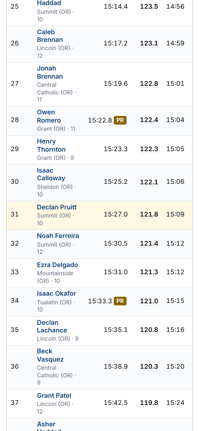

**Related: tooltips are clipped too.** Every badge and ⓘ tooltip opens *above* its element, so in a phone table the ones in the header and the first row are cut off at the top of the box:

`rating-explain.js` already shows its explanation as a bottom sheet on phones. Use that sheet for every tooltip.

---

## On phones, across the site

### Results start a screen or more down

| Page | What comes first | First row at |
|---|---|---|
| Race | meet link, title, meta, Share on its own line, course/day/weather, story, **a winner block that repeats row 1**, tabs, "Predict next year", grade picker, find box, dot chart | ~720 px |
| Rankings | 5 tabs (5th cut off), Breakouts · By state, title, subtitle, No. 1 line, filter panel, **a second search box** | ~790 px |
| Athlete | name, Follow + 2 lines of help, 4 stats, two rank lines, State line, 5 buttons, recruiting line, tabs, **an open chart** | ~900 px |
| School | Follow + help, chips, "State OR · Athletes 1843 · Racing 2006 to 2026", 6 links, tracker line, 13 year pills | ~880 px |
| State records | era note, Best race ever / season ever, 4 filters, tabs, "Advanced" | ~950 px |
| Course | girls' table after 15 boys rows + Show more + View all | girls ~1,100 px |
| Meets list | 8 filter fields, then two sets of tabs | ~600 px |
| Predictions from "Predict this meet" | a 3-step setup screen | Predict button at ~1,700–2,000 px |

 

*Race page: as built, then a mockup. The duplicate winner block is gone, course and day are in words, grade and find share one row, team scores are folded above the table, and the chart sits under it.*

### The column that matters is off-screen
| Page | Hidden column |
|---|---|
| Athlete seasons | **Rating** (8 columns, 640 px minimum width) |
| Recruiting | **You**, column 10 of 10 |
| Compare | **B's time and who won** |
| Recruit search | **ratings** |
| Venue | **Rating**, column 9 of 10 |
| Course | **date** |
| Rankings | **School** |
| Track meet | **Division**, so Varsity and JV events look identical |
| Track race | **Wind** |

The only hint is a faint fade on the right edge.

 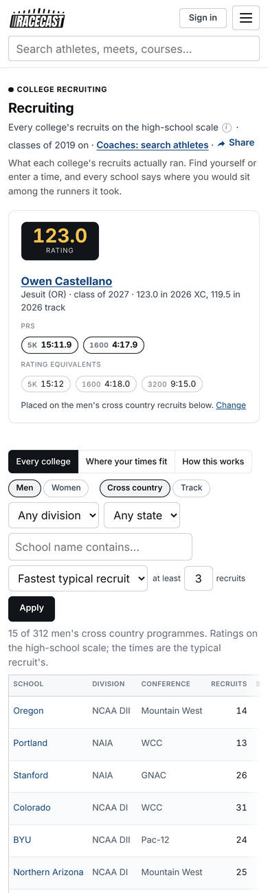 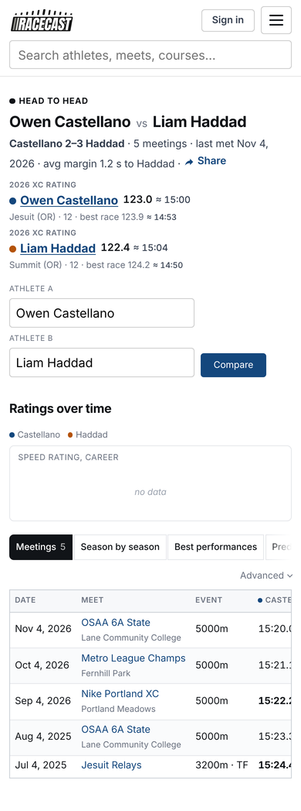

### Side cards fall to the very bottom
- **Which ones**: the athlete's **PRs and bests** (after every race and after "Report it"), the race's **Team scores** (after every row), course "Recent meets", the School PRs "Events" list, and the schools directory's "Biggest teams".
- **Why**: `layout.js`'s `foldSidebar()` should fold the athlete card to the top. It looks for `.page-layout`, which no template uses anymore, so it never runs.

 

### Rows get tall
- **Race rows are 3–4 lines.** The PR badge widens the Time column, so names wrap.
- **A long school name makes a 9-line row.**
- **Relays are 5–6 lines a row**: `race.css:167` puts every link on its own line, commas included.

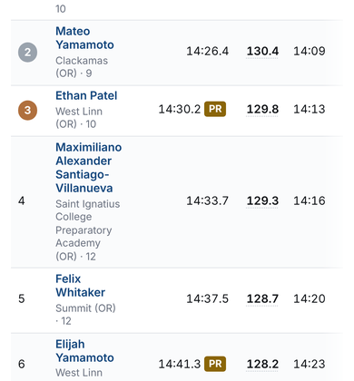 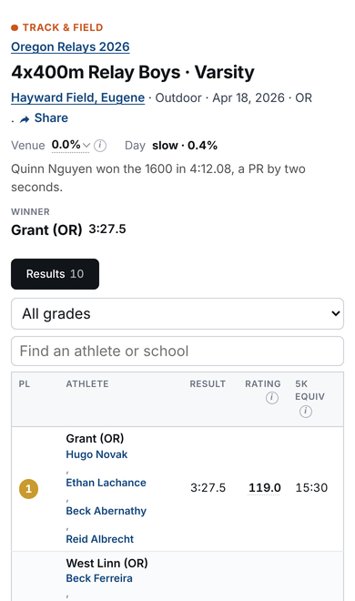

### Small screens, landscape, big races
- **320 px**:
  - long race titles take 3 lines;
  - the athlete name wraps beside the Follow help;
  - the rankings tabs and home photos run off the edge.
- **Landscape (844×390)**:
  - the race page **scrolls sideways** (the table is 891 px wide);
  - the two-row top bar plus the header fill the whole screen, so you see zero results;
  - between 701 and 760 px, race-family pages get half the phone layout (`race.css` switches at 760, `layout.js` and `style.css` at 700).
- **A 500-runner race on a mid-range phone (4× slower CPU)**:
  - about 2.3 s to load and 1.8 s of main-thread blocking, including one 0.8 s freeze;
  - the page is 37,000 px tall, about 44 screens;
  - each keystroke in the find box takes about 320 ms.

  It needs "first 50 + Show all", or "jump to my team".
- **Topbar**: 99 px tall on a phone, about 12% of the screen on every page.

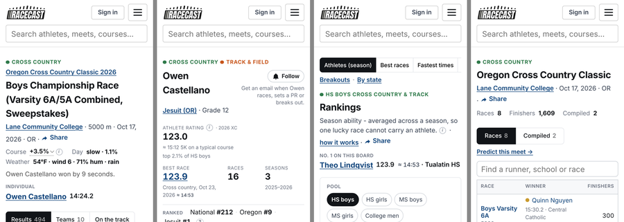
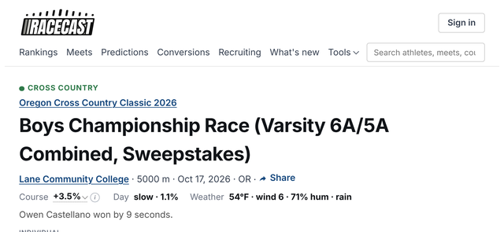

### Small text and small targets
- **Text**: column headers 9.8 px, stat labels 9.5 px, and the "≈ time" beside a rating 9.4 px. Overall, **11% of text on phones is under 11 px**. The root font is fixed at 14 px, which overrides the reader's own browser text size.
- **Targets**: ⓘ icons 14×14, rank links 17×16, badges 24×17, Share 55×24, tabs and chips 28–31 px tall, name links 15–19 px tall. There are 157 small targets on the race page and 198 on rankings.

---

## Athlete page
- **Nothing says whether 123.0 is good.** "Top 3%" is a 10.5 px grey sub-line. The ⓘ is a link to /scale, so on a phone a tap leaves the page.
- **Seven figures each look like "the" rating or time:**
  - athlete rating ≈ time;
  - best race ≈ time;
  - the season heading ≈ time;
  - the sidebar's best rating;
  - the sidebar's average rating;
  - the Rating column;
  - the 5K equiv column.
- **Two rank lines that can disagree.** `_grade_rank.html` counts by grade; the "Ranked" line (`app.py:1785-1830`) counts everyone. Neither says which.

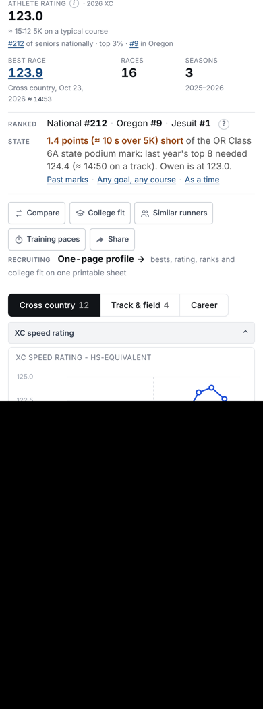

- **The headline time is a track 5K for an XC runner**: "≈ 15:12 5K on a track". The "State" line mixes rating points, track times and rating marks in one sentence, and it **disappears when its cache is cold** (`cuts.py:1227-1231`).
- **Five record badges** (PR, SR, CR, R, RSR, plus ★). R and RSR are told apart by letters alone.
- **Excluded races are labelled harshly**: "not counted", "not ranked", "out", with tooltips like "a jog, a race run easy, a bad day" and "usually a wrong distance… or two people's results under one name".
- **"Course +4.2%⌄" on every row** looks like a dropdown.
- **The chart**:
  - It opens by default, a full screen on a phone, above the races.
  - It's titled "XC SPEED RATING - HS-EQUIVALENT", with no "higher = faster", no times and no PR markers.
  - **An XC time series (`xc_pace`) is built and sent in the page but never drawn.**
  - **Tapping a dot on a phone scrolls away** to the race row (`athlete-charts.js:603-614`).
- **Comparing seasons takes mental arithmetic**: two headings 600 px apart.
- **Rating changes after recomputes are never explained on the page.**
- **Header clutter**:
  - Follow's help text takes 2 lines on a phone.
  - 5 action buttons, then a "RECRUITING · One-page profile" line.
  - The "Races" and "Seasons" stats answer no parent's question.
  - "Best race" is a rating, not a time.
- **On desktop**:
  - meet names are cut off ("Metro League Cha…") while other columns have room;
  - "· 2nd on team" runs into the rating;
  - the "2026 2025" jump links float alone.
- **Rank links don't deep-link**: "National #212" opens page 1 of the board with nothing lit, though `rankings.js` already has `jumpTo(personId)`. "Team #1" opens the roster with nothing lit.
- **There's no "Latest race".** "Next race" is the only line, and only for XC.
- **Sharing the page**: the share card shows "RATING 123.0 · BEST RACE 123.9 · RACES 16", with no time and no PR.
- **Unrated athletes** (sprints, hurdles, jumps and throws: the engine rates 600 m and up only):
  - the header shows a bare "–" under "ATHLETE RATING";
  - **an empty chart opens by default**;
  - every Rating cell is "–";
  - College fit and Similar runners are still offered;
  - no wind is shown;
  - nothing says ratings start at 600 m, while home says "Every result on one comparable scale".

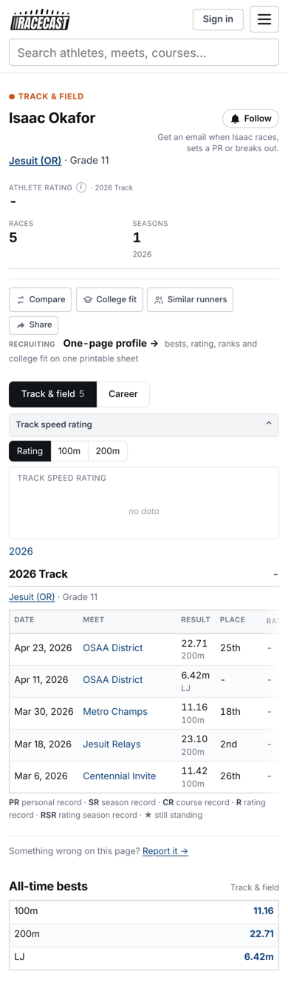 

## Race page (XC)
- Phone: see the iPhone bug, results-first and tall rows above.
- **The winner block repeats row 1.**
- **"Predict next year →" sits between the tabs and the table**, where it reads like part of the table.
- **The dot chart takes about 250 px above the table on a phone.** It's drawn in the track orange: the rating colors and the TF tag are 1.15:1 apart.
- **"Course +3.5%⌄" and "Day slow · 1.1%" are jargon.** The weather says "hum".
- **Team scores**:
  - tapping a team lights its runners, but that's hidden and has no "my team only" filter;
  - arriving with `?school=` doesn't filter the table or open the team popup;
  - on a phone, a coach's 19 runners span 12,500 px.
- **Two meanings of "PR" in one row**: a rating PR is badged "PR" and a rating SR "SR" (`_recflag.html:37-43`), right next to the time's PR/SR badges. The athlete page calls the same facts "R"/"RSR".
- **The share link drops `?r=`**, so it lands at the top of a 250-row race.
- **Desktop is the strongest page on the site.**

## Meet page
- **The model for the rest of the site**: one header, one tab bar, one table, two-line rows, no side card.
- **Issues**:
  - "Compiled" needs a plain name;
  - it marks the divisions your school ran in, but not how the team did;
  - the find box caps at 25 (XC) / 40 (track) results (`app.py:5284`, `:5330`).

## Track pages
- **Varsity and JV events look identical on a phone** (Division hidden). There's no way to narrow a 68-event meet except the find box.
- **Relays are 5–6 lines a row.**
- **Wind is hidden on phones**, and **wind-aided marks aren't marked anywhere** (no legal-wind check in the site code).
- **No overall place across heats.**
- **Different words from XC**:
  - "Equivalent times" vs "On the track";
  - "Venue" vs "Course";
  - "Event points" vs "Team scores".
- **Other jargon and clutter**:
  - "Venue 0.0%" shows on every outdoor race.
  - "Marks" is used for a count of results.
  - Next to "Pl", "Ran" reads like a second place column.
  - The meet has two Share buttons.
  - "Team scores" and "Compiled results →" show the same points.
  - A relay still shows the "All grades" picker.
- **"Combined" is explained well**: the compiled page's text on what combining means is good.

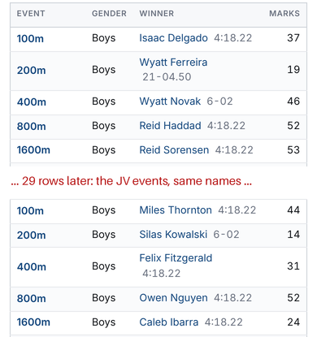

## Rankings
- **Phone**: the first athlete is about 790 px down. Tabs run off the edge ("Co"). The filter panel is about 450 px tall, with "Find an athlete on this board" as a second search box.
- **Tabs come above the h1** (on every other page they come after the header).
- **The board names are unclear**: "Athletes (season)", "Best races" and "Fastest times" don't say how they differ.
- **"Pool" for level.**
- **Locked dependent filters**: 1.9:1 text, no "disabled" state, still reachable by keyboard.
- **Desktop**:
  - 10 columns beside a 280 px card, so schools wrap to 3 lines and "RACES" is cut off;
  - **Sport and Year repeat the filter on every row**;
  - the Year column says "2026-27" where athlete pages say "2026 XC".
- **The page title never changes** with the board.
- **Default is always HS boys.**
- **Breakouts and movers each show a different strip of boards**, and nothing links to /movers.

 

## Course page
- **It opens on the wrong question**: "All distances, ranked by rating". The header shows "Boys best 132.7", a rating. The **course record shows only after tapping the 5000m pill.**
- **Tabs**: up to 7, and they change with the distance pill. On a phone "On the track" shows as "On t".
- **"5K equiv" disagrees with the real 5K beside it** (14:40 at 5000 m next to 13:34): it is a track 5K, and the label doesn't say so.
- **"Difficulty +3.5%" is a bare number.** `difficulty_words()` already writes the sentence ("about 20 s slower…").
- **"Results 118,420 · Athletes 61,203" is noise.**
- **College courses say Boys/Girls.**
- **"Show 20 more (1 left)"**: the 20 is hard-coded.
- **"Advanced: each pool's own scale" is on the page.**

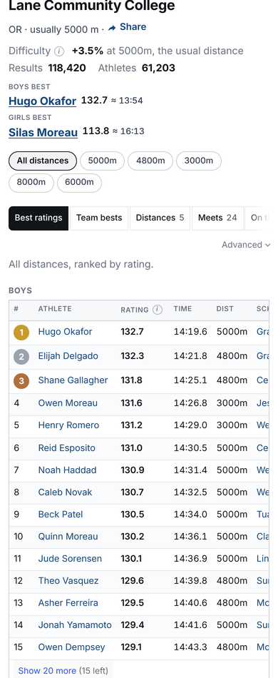 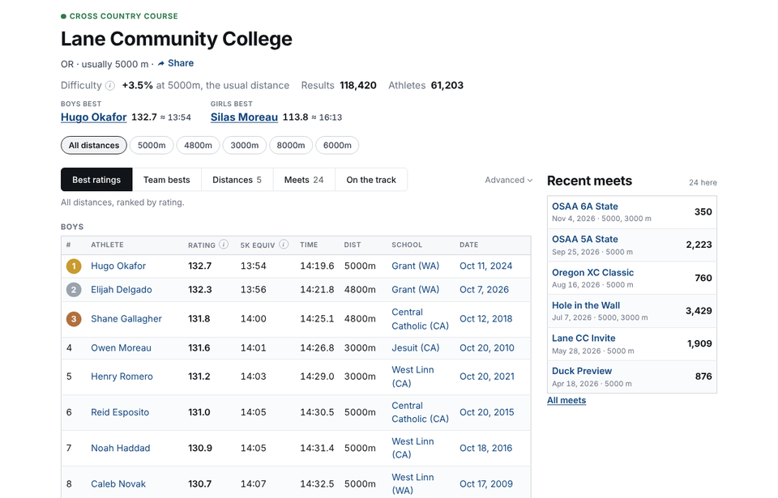

## School page and team tools
- **About 880 px of header on a phone.** "State OR" repeats the "(OR)", and "Athletes 1843" means ever, not now.
- **Four overlapping "best" lists**:
  - Best athletes;
  - Best performances (no time or meet);
  - School PRs;
  - the Record book (both a link and a tab).
- **The roster** has ratings only: no times, no trend, no varsity line, no sorting.
- **The Races tab** shows "Average rating", not the team's place and score.
- **The team's own rank is missing** from the school page, though the embed widget shows it.
- **The season tracker**:
  - is the best coach tool on the site, behind one muted line;
  - HS only;
  - "0th" at the top of its chart;
  - the "1–5 gap" is in rating points, and its chart rises as things get worse;
  - the top 7 is a run-on list, hidden on phones;
  - its error state prints the exception name.
- **Best-seven lineup optimiser and dual-meet scorer**: exist only as the 3rd tab of Predictions results.
- **Exports and printing**:
  - no CSV for the roster, tracker, athlete history, whole meet, predictions or recruit search;
  - **printing** a roster prints the nav and 15 rows, not the whole roster.
- **The embed widget**: buried at the bottom, set too short (520 px for 686 px of content), and has no column labels.
- **Developer and odd copy**:
  - "until they turn out for someone else";
  - "Meet calendar (.ics)";
  - "Season tables are rebuilding… everything below is live".
- **School PRs**: "Boys best" is the highest rating across events, not a record. Two walls of pills come before any table.
- **State records**: "records" are ranked by rating, not time. The team table has two ranks per row. The era note is model talk.

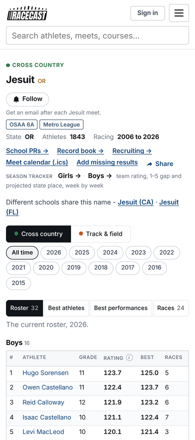 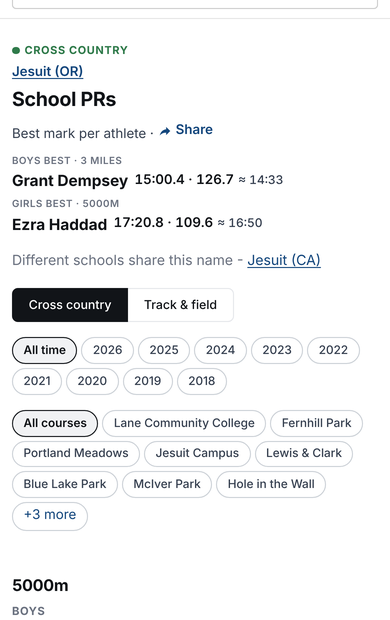

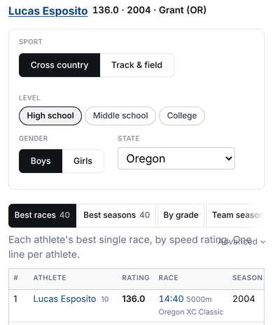

*Records page: "Advanced" draws over the lead text on a phone.*

More in [the coach walk-throughs](REVIEW-UX-2026-10-COACHES.md).

## Home page
- **Strong**: the hero sentence ("100 is an average high schooler, about a … 5K") and the four task cards.
- **Phone, first screen**:
  - two search boxes;
  - photos come before the search;
  - "Latest results" is a national list about 2,200 px down, with an unlabelled count column.
- **The board header overlaps on a phone**: the Rating ⓘ sits on top of "5K EQUIV".
- **Middle school is missing** from home.
- **The default is HS boys.**
- **"Share" falls onto its own line with a stray "·".** This happens on race, meet, rankings, course and school too.
- **On a phone, home's h2 is bigger than its h1.**

 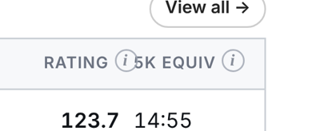

## Predictions, state odds, what it takes, goal
- **The opening is clear.** Drop "test the model against what happened".
- **"Predict this meet" lands on a setup screen**: 9 race pills, groupings, Show/Squads, a team box per race. It should run with defaults and show the result.
- **Model talk**:
  - "8 draws out of 10", "mean, sd";
  - "Coalesce is on: ONE squad";
  - "the card", never defined;
  - "lineups raced";
  - "flat-5K equivalents".
- **Weather forecasts in °C, km/h and mm** (`forecast.py:220-238`), while race pages use °F and mph.
- **The meet preview has no find box and no highlight.**
- **One feature, three names**: "Who wins state", "STATE PROJECTION", "State odds". The state odds page says "Model estimates, not predictions" inside Predictions.
- **The season rating is explained three different ways**: "averaged", "80th-percentile race", "100 is the group's average runner" (`scale.html:93`).
- **/goal ("What do I need to run?")**:
  - the best answer page on the site;
  - HS XC only;
  - called "Goal calculator" in Tools;
  - its main button looks like a "show more" link.
- **"What it takes to make state"** undersells a page that also covers top 25 and top 8.

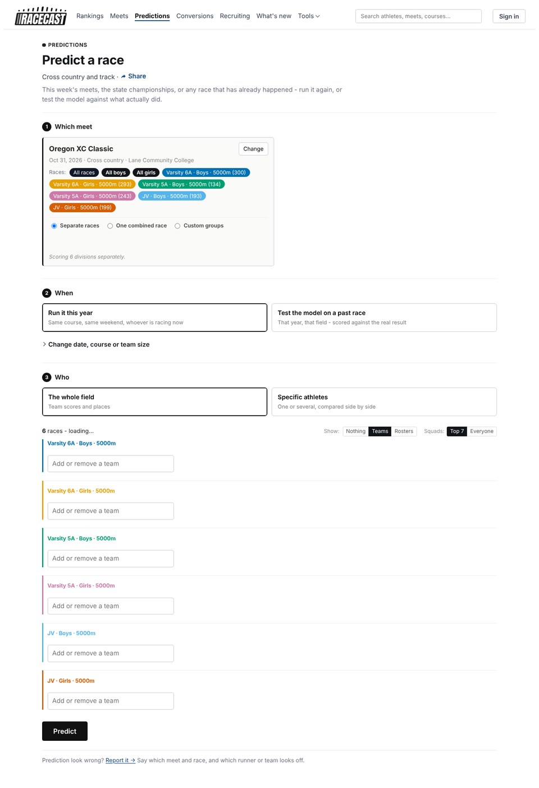

## Conversions
- **The form reads like a spreadsheet**:
  - "Source / Pool / Sport";
  - "Time (hh:mm:ss)", pre-filled with 00:00:00;
  - "Distance (m)";
  - "Apparent temp", "Precip (mm)", "Soil (mud)".
- **The answer is in an odd place**: it appears above the form and the times below it, so nothing changes near Convert.
- **Defaults**: the XC tab is the default ahead of Track, and times show hundredths ("16:25.26").
- **"(own pool)" is visible.**
- **The paces section dead-ends for a typed time** ("Pick an athlete as the source…", with no picker there). It also says "critical speed" and "VO2max".
- **Accessibility**: the distance field has no label at all.
- *(The "0 courses · 0 track distances" subtitle in the first version was my empty test data; with data it reads "10 courses · 7 track distances", which is fine.)*

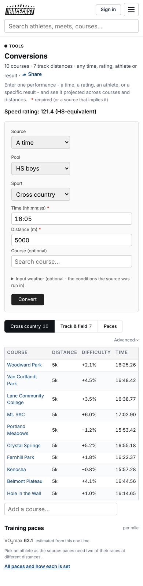

## Recruiting and coach tools
- **Off-screen and hidden answers**:
  - "You" is off-screen on a phone;
  - the grouped answer is tab 2;
  - the gap is in rating points rather than seconds;
  - "N schools, fastest 3 shown" has no way to see the rest.
- **Three different sets of tier names** (`recruiting.py:562-569`, `recruiting_school.html:105`, `shortlist.py:128-132`).
- **Two "recruiting profile" pages**: `/athlete/<id>/profile` and `/recruit/<id>`. "Runners like you" leads with statistics.
- **Saving a college** only works from the college's own page.
- **College fit is offered to unrated athletes.**
- **Recruit search** (coaches):
  - filters by rating, not time;
  - no track event filter;
  - key filters below the button;
  - placeholders that look like values;
  - no PR times in results;
  - 10 sort options;
  - no CSV;
  - no way to save recruits ("College shortlist" is for athletes).
- **The /coaches page**: a "Being built 3" tab, "corpus", "programme", "unit".

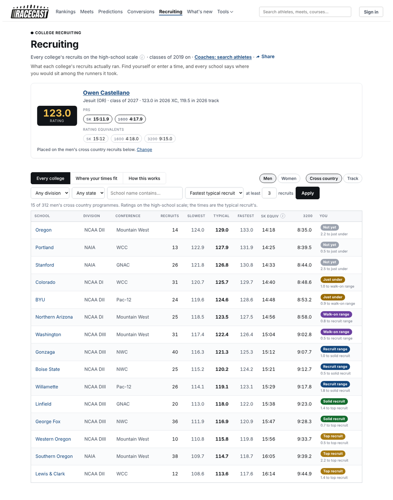 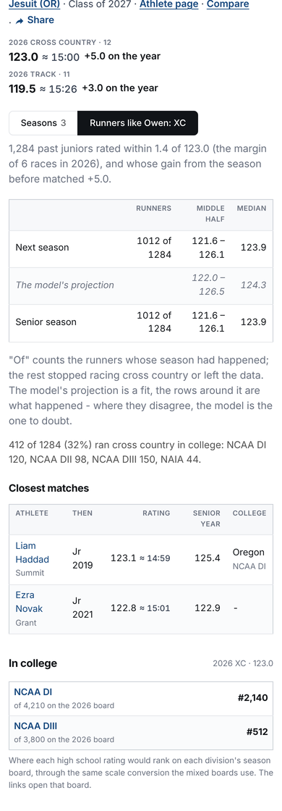

## Compare
- **One page, three names**: "Head to head" as the page title, "Compare" on the button, "Compare two athletes" in Tools.
- **Box B** has no placeholder and no suggestions.
- **The button** sits beside B only, and it's blue (the only filled colored button on the site).
- **On a phone**: B's time and the margin are off-screen, and the 4th tab is clipped.
- **"Advanced" scale switch** on a parent-facing page.
- **Athletes only**: no team-against-team compare, and a 2-athlete limit.

## Search
- **Same-name runners look identical** (the label is the school only, `search_index.py:338`).
- **Exact matching only**: no typo or nickname tolerance. "Jake" doesn't find "Jacob". Trigram similarity is already indexed but unused here.
- **The results page**:
  - its tabs run off a phone ("Ver…");
  - Venues vs Courses is unexplained;
  - the type column is lowercase;
  - it scrolls sideways at 320 px.
- **The sub-line that tells runners apart** is #888, 3.5:1 contrast.
- **No screen-reader support** in the dropdown (no combobox roles, no result count).

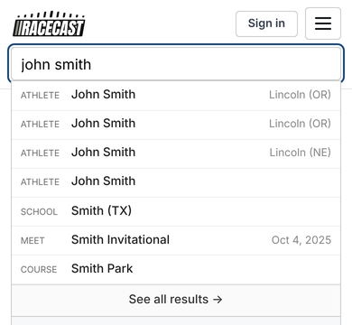

## Meets list
- **Filters**: 8 fields come before any meet on a phone.
- **Duplicate controls**: a Sport dropdown *and* Sport tabs.
- **The School filter** is an exact text match with no autocomplete (`meets_filter.py:205`). "Jesuit HS" finds nothing.
- **Copy**: "real fields (+ results)", "cleared the results floor".
- **The kicker** is a lone dot with no word.

## Accounts, following and claiming
- **A signed-out Follow doesn't follow.** You sign in, come back, and have to tap again (`follows.py:429`).
- **The login page**:
  - its "What an account does" never mentions following;
  - it says an account "places you on the recruiting boards", which alarms a parent of a minor;
  - it shows "the reason is in the server log".
- **The avatar goes to Settings**, not My page.
- **Claiming**:
  - not on athlete pages, though `contact.html` says it is;
  - lives in Settings, worded for the athlete;
  - unverified;
  - "parent" appears nowhere.
- **"Following. Click to stop."**: one tap unfollows, no undo, and "click" on a phone.
- **Email digests**: off unless `XCP_ALERTS=1`. The promise "after each meet" actually means the next morning.
- **No public way to ask for a minor's page to be hidden**, though the backend supports it (`person_optout.py`).

## Report, fix and upload
- **Report form**:
  - shows a raw path ("/race/xc/1234/2") twice;
  - preselects "A rating looks wrong" for everything;
  - "missing result" doesn't point to uploads.
- **"Suggest a fix"** (structured, good) only appears to signed-in claimants.
- **Uploads**:
  - the clearest flow on the site;
  - no PDF or photo upload, which is what parents have;
  - "Relays and field events are skipped" is buried;
  - the guest email field is unstyled.
- **"Report it"** is missing from course, rankings, records, school PRs, compare and conversions.

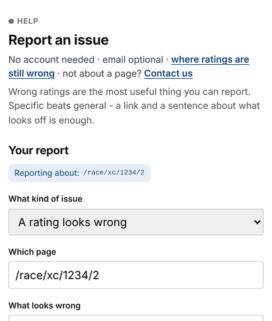

## "How this was rated" (tap a rating)
- **Good structure, written in builder's words**:
  - "distance curve";
  - "**the engine applies 0.92x of a course at this ability**" (the tilt, shown to the public);
  - "normalised before the latest refit … until the next backfill";
  - "reference era";
  - "the weather grid".
- **For MS and college runners** the sheet ends on a different number than the page shows, and names two scales (`rating-explain.js:266`).
- **No focus trap** (accessibility).

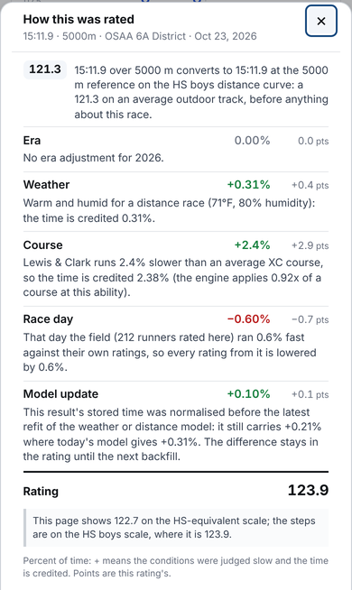

## Navigation and naming
- **Top bar**: 6 links plus Tools. "What's new" competes with what parents do.
- **Tools labels don't match page titles**:
  - "Goal calculator" vs "What do I need to run?";
  - "Compare two athletes" vs "Head to head";
  - "Who wins state" vs "State projection".
- **Recruiting has six names** across the site.
- **The same lists have different tab names on every page**: Best performances / Best ratings / Best races / Best athletes.
- **Seasons are named two ways**: "2026-27" vs "2026 XC".
- **Two sport controls** on the meets list; **two search boxes** on rankings and home.
- **The "Advanced: each pool's own scale" switch** is on 7 pages (compare, conversions, course, venue, breakouts, records, school records).

## Minors and tone
- **Named lists of minors at the bottom**: the forecast recap publicly lists, by name, the high schoolers who "**Fell short of it the most**" (`meet_recap.html:106`). Its meta description advertises "the top ten named". Movers has a "**Fallers**" tab.
- **Questioning a kid's best race in public**: "Not ranked… usually a wrong distance… or two people's results under one name". Breakouts: "a jump this large is usually a data error".
- **Social posts invite critique of named minors**: "Who's too low?" and "Who's missing?".
- **Every default is boys**: rankings, home, goal, recruiting, course order. The rating tooltip says "an average high-school runner", not "…girl", on girls' pages.

## Wording, design and accessibility (details in the companion files)
- **Wording**:
  - about 35 visible uses of "pool";
  - "HS-equivalent" named on a one-scale site;
  - developer text such as "racecast/follows.py --init", "pipeline run (step 10f)" and raw exception names;
  - British spellings (programme, normalised, labelled, neighbouring);
  - 11 different find-box placeholders;
  - 53 " - " and 8 " -- " used as dashes;
  - Title Case mixed with sentence case;
  - "affect" for "effect" on About.
- **Design**:
  - 91 font sizes, 214 colors (gold carries 8 meanings), 9 different primary buttons, 66 control looks, 18 link styles, 18 breakpoints;
  - **a 297-line block duplicated word for word in `style.css`** (2111-2407 and 2464-2760);
  - `race.css` acting as a second global sheet;
  - tokens bypassed (124 hand-typed `#6b7280`).
- **Accessibility**:
  - no skip link (a 250-runner race is about 1,000 tab stops);
  - tabs without arrow keys;
  - tooltips that Escape doesn't close;
  - comboboxes with no ARIA;
  - unlabelled conversion fields;
  - medal numerals at 2.6:1;
  - links shown by color only;
  - field borders at 1.5:1;
  - silent board updates;
  - no forced-colors support.
  - The rankings "Any" picker itself is fine. The 1.9:1 reading in the first version belongs to the locked dependent filters.

## Performance
- **CSS**: every page blocks on about 90 KB of gzipped CSS, and 40% of `style.css` is comments.
- **JavaScript and images**: `predictions.js` is 74 KB gzipped; home photos are 528 KB.
- **Big races**: a 500-runner race freezes a mid-range phone (see Phone).
- **Layout shift**: about 0 everywhere. Good.

---

*Corrections to earlier versions:*
- *"5K equiv on a 100 m" was test data: the engine doesn't rate events under 600 m, which is a bigger problem (see Athlete page, unrated athletes).*
- *The rankings "Any" contrast reading belonged to the locked filters.*
- *The conversions subtitle was my empty test data.*
