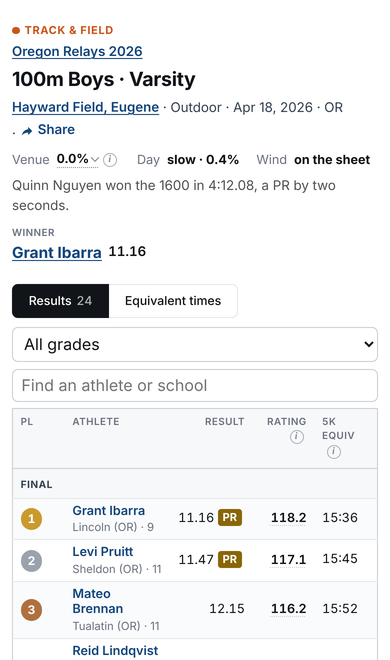

# Racecast UX review: October 2026

This review is written for the people who use the site: runners (MS, HS, college), their parents and coaches, and most of them are on a phone. It is not a code review.

**How I looked.** I rendered the real templates locally with made-up sample data and took screenshots in Chromium at 390 px (iPhone 13) and 1280 px. Pages driven by JavaScript got mocked API answers. I did not use the live site, and I did not have Safari. Names and numbers in the shots are fake. Pages marked *(template)* were read, not rendered. Screenshots are in `docs/ux-2026-10/`. In mockups, the parts I changed have a dashed blue outline. Every claim about code was checked against the file and line given.

---

## The ten biggest problems

### 1. On a phone, the answer starts a screen or more down the page

"Results first" holds on desktop, but not on a phone.

| Page | What comes before the first row | First row at |
|---|---|---|
| Race | meet link, title, meta, Share on its own line, course/day/weather, story, **a winner block that repeats row 1**, tabs, "Predict next year", grade picker, find box, dot chart | ~720 px |
| Rankings | 5 tabs (the 5th cut off), Breakouts · By state, title, subtitle, No. 1 line, filter panel, **a second search box** | ~790 px |
| Athlete | name, Follow + 2 lines of help, 4 stats, ranks, 5 buttons, recruiting line, tabs, **an open chart** | ~900 px |
| School | Follow + help, chips, "State OR · Athletes 1843 · Racing 2006 to 2026", 6 links, season-tracker line, 13 year pills | ~880 px |
| State records | era note, Best race ever / Best season ever, 4 filters, tabs, "Advanced" | ~950 px |
| Course | the girls' table starts after the boys' 15 rows + "Show more" + "View all" | girls ~1,100 px |
| Predictions (from "Predict this meet") | a 3-step setup screen: 9 race pills, groupings, Show/Squads, a team box per race | Predict button ~1,700–2,000 px |

 

*Race page on a phone: as built (left), mockup (right). In the mockup the duplicate winner block is gone, course and day are in plain words, grade and find share one row, team scores are folded above the table, and the dot chart is under it. The first runner is on the first screen.*

### 2. Following a link into a race drops you mid-table (likely the iPhone "cut off at the top" bug)

Every meet link on an athlete page carries `?r=<result id>`, and `race.html:241-248` then scrolls that row to the **centre** of the screen. On a phone you land with no meet name, no race title and no column headers. This is the most common way a parent reaches a race page. Details and two other suspects are in [the iPhone bug section](#the-iphone-table-cut-off-at-the-top-bug).

### 3. On a phone, the key column is off-screen and side cards fall to the bottom

The same two faults repeat across the site:

- **The column that matters is off the right edge.**

  | Page | Hidden column |
  |---|---|
  | Athlete season table | **Rating** (8 columns, 640 px minimum) |
  | Recruiting | the **You** tier: column 10 of 10 (`recruiting.js:243-249`) |
  | Compare | **B's time and who won** |
  | Venue | **Rating**: column 9 of 10 *(template)* |
  | Course | the record's **date** |
  | Rankings | **School** |

  The only hint is a faint fade.
- **Side cards drop to the very bottom on a phone.** This hits the athlete's **PRs and bests** (after every race and after "Report it"), the race's **Team scores** (after 60, or 250, rows), course "Recent meets", the School PRs "Events" jump list, and the schools directory "Biggest teams". `layout.js` has code that folds the athlete sidebar into a "Bests & PRs" bar at the top, but it looks for `.page-layout`, which no template uses anymore, so it never runs. This is a silent regression.

  

*Left: Rating is off-screen. Middle: the bests come last. Right: mockup with one headline number and sentence, 4 buttons, "PRs & bests" folded at the top, the chart folded, and a season table (Meet with date, Result, Place, Rating) that fits.*

 

### 4. Too many numbers, and the "5K" doesn't mean what it says

- An athlete page shows **seven figures that each look like "the" rating or time**:
  - Athlete rating ≈ time
  - Best race ≈ time
  - the season heading ≈ time
  - sidebar Best rating
  - sidebar Average rating
  - the Rating column
  - the 5K equiv column

  It also has **five record badges** (PR, SR, CR, R, RSR, plus ★), a "Course +4.2%⌄" cell on every row, and three ranks.
- **"5K equiv" is a track 5K, but it isn't labelled as one.**
  - Beside a real XC 5K it disagrees: a state record reads "14:40 · 5000m" next to "5K equiv 13:34" (`course-desktop.png`).
  - It also shows on sprints: an 11.16 100 m reads "5K equiv 15:36" (`_scale.html:56`, `tf-sprint-phone.png`).
  - Recruiting shows both "PRs 15:11.9" and "Rating equivalents 15:12".
- **The season rating is explained three ways**:
  - "averaged across a season" (`rankings.js:2239`);
  - "80th-percentile race" (`projections.html:325`, `team_season.html:94`);
  - "100 is the group's average runner" (`scale.html:93`), against "100 is an average high-school runner" everywhere else.

### 5. Jargon and developer text

| On the site | Where | Suggest |
|---|---|---|
| **Pool** | rankings filter, conversions, About ×15 | **Level** |
| **Course +3.5%⌄** / **Difficulty +3.5%** | race header, athlete rows, course header | "Course: **harder than average** (about 20 s on a 5K)". `difficulty_words()` already writes it. |
| **Day slow · 1.1%** | race header | "Conditions: **slightly slow**" |
| **Venue 0.0%** | every outdoor track race | hide when 0 |
| **Compiled**; **Ran** next to Pl (`compiled.html:124`) | meet pages, combined results | **Combined results**; "Place in own race" |
| **Marks** = number of results | track meet page | **Results** (to a track parent a mark is a time) |
| **XC SPEED RATING - HS-EQUIVALENT** | athlete chart | **Speed rating** |
| **5K EQUIV ⓘ** (3 lines on a phone) | every table | **Track 5K ≈** on one line |
| **R, RSR** | athlete rows | PR and SR only by default |
| **1–5 gap** (rating points), **mean of the top five** | school, season tracker | the gap in **seconds**, the way coaches think of it |
| **Meet calendar (.ics)** | school | "Add meets to my calendar" |
| **programmes**, **corpus**, **unit**, **THIN** | recruiting, coaches, state odds | plain words |
| **Being built 3** (a tab) | `/coaches` (`coaches.html:64`) | hide unfinished work |
| "**…not set up on this server yet (racecast/follows.py --init)**" | `shortlist.html:60`, `my_page.html:56`, `fixes.html:38`, `login.html` "server log" | "Not available yet." |
| "could not be computed just now (**{{ data.error }}**)" | team season tracker | never show the raw error |
| era note (`record_books.py:27`), roster note ("until they turn out for someone else"), "nightly data run" | records, school | "Ratings compare runners across years; times are as run." / "Hasn't raced yet this season." |
| "Model estimates, **not predictions**" | `state_odds.html:64`, inside Predictions | say what it is: "Chances, from this season's ratings" |
| "Meets from the last year with real fields (+ results)", "cleared the results floor" | meets list | "Recent meets, newest first" / "No meets match." |
| **"How this was rated"** text | tap a rating | [see below](#how-this-was-rated-tap-a-rating) |

The best explanation on the site is the home page's sentence *"100 is an average high schooler, about a [time] 5K."* Make it the first line of the rating ⓘ everywhere. Right now that ⓘ is a **link** to /scale, so on a phone a tap may leave the page.

### 6. One thing, several names

- **Compare**: "Compare" (button), "Compare two athletes" (Tools), "**Head to head**" (the page).
- **Recruiting**: "Recruiting", "College fit", "Where would I fit in college", "Athletes: where you'd fit", "Similar runners", "One-page profile" and "Recruit search". There are also **two separate profile pages**: `/athlete/<id>/profile` ("One-page profile") and `/recruit/<id>` (tagged "Recruiting profile", linked as "Similar runners").
- **State**: "Who wins state" (Tools), "STATE PROJECTION" (tag), "State odds" (sibling page).
- **The same lists under different tab names on every page**: "Best performances" (school, venue), "Best ratings" (course), "Best races" (rankings, records), "Best athletes" (school). Team bests/Team records/Team seasons likewise.
- **XC and track pages use different words for the same parts**: "On the track" vs "Equivalent times", "Course" vs "Venue", "Team scores" vs "Event points".
- **Seasons**: rankings says "2026-27" (`rankings.js:582`), while athlete pages say "2026 XC" / "2027 TF" for the same year. `app.py:3162` claims the two agree.
- **The rankings family**: rankings, breakouts and movers each show a **different strip of boards**, and nothing on the site links to /movers.
- **Two search boxes on one screen**: rankings ("Find an athlete on this board"), and home on a phone. **Two sport controls** on the meets list (dropdown + tabs). **Two Share buttons** on the track meet page.

### 7. Parents can't easily follow or claim a runner

- **A signed-out tap on Follow doesn't follow.** It sends you to sign in and back to the page, still not following (`follows.py:429`, `account_return`: "Changes nothing else").
- **The login page's "What an account does" never mentions following.**
- **Claiming a page can't be found from the page.** `contact.html` says "claim it from your athlete page", but no such link exists there. Claiming lives in Settings, worded for the athlete. The word "parent" appears nowhere in login, account or My page.
- **The signed-in avatar goes to Settings** (`topbar-search.js:189`), not to My page.

### 8. Tools that make you work before giving the answer

- **Predictions**: "Predict this meet →" opens a setup screen, not a prediction. Run with defaults, show the result, and fold "Adjust".
- **Recruiting**: after "Place me", the "Every college" table stays open, and the grouped answer ("Where your times fit") is tab 2. The gap reads in rating points ("2.2 to just under") where a parent needs seconds. Six tier names, and the top one reads "Top recruit" or "Scholarship range" depending on the division (`recruiting.py:569,624`).
- **Runners like you** (`recruit.html:95-135`) leads with statistics ("1,284 past juniors rated within 1.4 of 123.0 (the margin of 6 races…)", "Middle half 121.6 – 126.1", "the model is the one to doubt"). "32% ran in college" is at the bottom.
- **Conversions**: the answer appears **above** the form and the times **below** it, so nothing changes next to the Convert button. The default tab is 10 famous XC courses rather than 1600/3200, times come with hundredths ("16:25.26"), and "(own pool)" shows (`conversions.js:435`).
- **The goal page ("What do I need to run?")** answers the parent question best, but it's buried in Tools as "Goal calculator", and its main button is styled like a secondary link (`goal.html:112`).

### 9. Track pages on a phone

- **Varsity and JV events look identical**: the Division column is hidden on phones, so "100m Boys" appears twice with nothing to tell them apart. That's how a parent looks for their kid's event at a 68-event meet, and there's no filter but the find box.
- **Relays are 5–6 lines a row**: `race.css:167` puts every link in the name cell on its own line, so each leg and its comma stack.
- **Wind**: the column is hidden on phones, and **nothing marks a wind-aided mark** (no "w"; no legal-wind check anywhere in the site code).
- **No overall place** across heats.
- The **5K column on sprints** (problem 4).

 

### 10. A tone problem with minors

The forecast recap (`meet_recap.html:106`) publicly lists, by name, the high schoolers who "**Fell short of it the most**". A 15-year-old finding their name on a "fell short" list on a public site, with a % gap, is the kind of thing that turns a parent against the site. Keep "Beat our forecast", and show the misses as a count or for teams only.

---

## The iPhone "table cut off at the top" bug

**First suspect: arriving from a link** (problem 2). Every meet link on an athlete page carries `?r=`. `race.html:241-248` calls `scrollIntoView({block: "center"})` on that row, and `race-page.js:684-690` and `link-flash.js` do the same for other entries. On a phone you see rows with no header above them.

Fix: scroll so the table's header row sits at the top of the screen, and scroll further only if the row would otherwise be off-screen. Or add a slim sticky bar with the race name and column labels. A sticky `<thead>` won't work inside `.tscroll`, because sticky elements stick to their nearest scrolling box, not to the page.

**Second suspect: tooltips.** Every `.flag::after` tooltip opens **above** its element, and on phones every table sits in `div.tscroll` with `overflow-y: hidden`. So tooltips on the header (Rating ⓘ, 5K ⓘ) and on the first row (PR badge) are cut off at the top of the box. This reproduces in Chromium too:

If your screenshot shows rows missing *without* either of these, check two more things: the `-webkit-mask-image` that `.tscroll.has-more` puts on a scrolling box (turn it off to test), and `width: 0; min-width: 100%` on `.tscroll` inside the `.rc-grid` grid.

**Please send the screenshot.** The tooltip clip is worth fixing either way. The site already has the fix pattern: `rating-explain.js` shows its explanation as a bottom sheet on phones for exactly this reason. The badge and ⓘ tooltips should reuse that sheet.

---

## "How this was rated" (tap a rating)

A good structure (a bottom sheet with steps, percentages and points), written in the builder's words. The text comes from `racecast/explain_rating.py`; the screenshot uses mocked data:

- "converts … on the HS boys **distance curve**" (`:377`)
- "(the **engine applies 0.92x of a course at this ability**)": the tilt, shown to the public (`:498`)
- "stored time was **normalised before the latest refit** … until the **next backfill**" (`:471`): a maintenance note, not an explanation
- "the **reference era**" (`:416`)
- For MS and college runners the sheet ends on a **different number than the page shows** and names two scales (`rating-explain.js:266`). That brings back the two-scale idea.

Suggest: one plain sentence first ("15:11.9 on a course about 2% slower than average, on a slightly fast day → **123.9**"), then the steps, folded. Drop the tilt clause and the "Model update" step.

---

## Across the site

- **Small text on phones.** The `.7rem` uppercase column headers come out at **9.8 px**, stat labels at 9.5 px, and the "≈ 14:53" after a rating at 9.4 px. Use 11 px or more, without uppercase, on phones.
- **Tap targets.** At 390 px, ⓘ icons are 14×14, rank links 17×16, PR badges 24×17, Share 55×24, rankings tabs and chips 28–31 px tall, and name links 15–19 px tall. The race page has 157 controls under 32 px; rankings has 198. Make whole rows tappable and give small icons a bigger hit area.
- **Contrast.** The rankings State picker's "Any" is **1.9:1** (caret 1.5:1), the 9 px "State division / class" label is 3.5:1, and plain rank numbers are 3.8:1. The rest passed.
- **Page weight.** Every page blocks on `style.css` (74 KB gzipped, **40% of it comments**) plus `race.css` (16 KB). Stripping comments at deploy would save about a third. `predictions.js` is 74 KB gzipped.
- **No layout jumps** (measured on race, athlete, rankings and home). Good.
- **The "Advanced: each pool's own scale" switch** is still on compare, conversions, course, venue, breakouts, records and school records (`_scale.html:85`). On the records page on a phone it **draws over the lead text** (`records-phone-advanced-overlap.png`). You need to decide whether these count as "multi-pool boards". Compare and conversions are parent pages, and the switch shouldn't be there.
- **"Show 20 more (1 left)"** on every school, course and PR table: the 20 is hard-coded (`course.html:41`, `school.html`, `school_prs.html`, `staged.js:62`).
- **Share is in a different place on every page** (it's the 7th link on the school page and mid-line on the tracker), with a stray "·" on phones. Its markup is copied into about 15 templates and none use `_share.html`.

---

## Page by page

### Race (`race.html`)
- Phone: problems 1 and 2. "Predict next year →" sits between tabs and table and reads like part of the table.
- **Rows are 3–4 lines** on a phone because the PR badge widens the Time column. Two lines is right (name; school · grade). Make PR a small mark after the time.
- **The dot chart** costs about 250 px above the table on a phone. Move it under the table, folded.
- **Team scores**: tapping a team on desktop lights its runners, which is clever but hidden.
- Desktop: the strongest page.

### Athlete (`athlete.html`)
- Problems 3 and 4.
- The Follow help text takes 2 lines on a phone.
- 5 action buttons plus a "RECRUITING · One-page profile" line (`_next_race.html`). Keep 3 + More.
- **The chart opens by default** and is a full screen on a phone. Fold it.
- Desktop: meet names are cut off ("Metro League Cha…") while other columns have room, and "· 2nd on team" runs into the rating.
- "2026 2025" jump links float alone above the first season.

### Rankings (`rankings.html`, `rankings.js`)
- Phone: problem 1. 5 tabs scroll sideways, and "Courses" shows as "Co".
- **"Athletes (season)" / "Best races" / "Fastest times"**: the difference isn't obvious. Try "Top runners this season", "Best single races", "Fastest times".
- Desktop: 10 columns beside a 280 px card, so schools wrap to 3 lines and "RACES" is cut off. **Sport and Year repeat the filter** on every row.

 

*Mockup: the boards as one picker, filters as one row (Level, State, Filters), and no second search. The board starts on the first screen.*

### Meet (`meet.html`): the model to copy
One header, one tab bar, one table, two-line rows, no side card. Only "Compiled" needs renaming.

### Course (`course.html`)
- **It opens on the wrong question.** It shows "All distances, ranked by rating", the header shows "Boys best 132.7" (a rating, not a time), and 5000/4800/3000 m are mixed in one table. The **course record ("14:32.5") appears only after tapping the 5000m pill.** Open at the usual distance (`primary_dist` is already computed) with Records first.
- **The tabs change with the pill** (Best ratings / Team bests / Distances / Meets / On the track vs Records / Team records / Best ratings / Meets / On the track). On a phone "On the track" is cut to "On t".
- "Results 118,420 · Athletes 61,203" is noise. College courses say Boys/Girls (`course.html:156-158`).

 

### School (`school.html`, `school_prs.html`, record book)
- **About 880 px of header** on a phone (problem 1). "State OR" repeats the "(OR)" beside the name, and "Athletes 1843" means ever, not now.
- **Four overlapping "best" lists**:
  - Best athletes;
  - Best performances (no time, no meet name, only a date);
  - School PRs;
  - the Record book, which is both a link and a tab.

  Suggest three tabs: **Roster · Records · Races**.
- PR page: "Boys best" in the header is the highest rating across events, which may not be the 5000m record holder. 10 year pills and 8 course pills (~380 px) come before any table; use two dropdowns.
- *(template)* The schools directory has no find box and can list hundreds of schools.

 

### Track (`race_tf.html`, `meet_tf.html`, `compiled*.html`)
- Problem 9.
- The meet page's "Team scores" tab and "Compiled results →" show the same computed team points.
- A relay page still shows the "All grades" picker.
- The explanation of what "combining" means on compiled pages is good.

### Home (`home.html`)
- Good: the hero sentence and the four "Look up a runner / Predict / Convert / College fit" cards.
- Phone: two search boxes on the first screen, and photos above the search. Put the search first.

### Predictions (`predictions.html`)
- The opening is clear (this week's meets, Who wins state, Re-run a past race). Drop "test the model against what happened".
- After a meet is chosen: problem 8.

### Conversions (`conversions.html`)
- Problem 8. Suggest one sentence: **"I ran [16:05] for [5K] at [course] → 1600 ≈ 4:38 · 3200 ≈ 10:05"**, with Track first.
- The paces section dead-ends for a typed time ("Pick an athlete as the source…", with no athlete picker there).

### Recruiting (`recruiting.html`, `recruit.html`, `athlete_profile.html`, `coaches.html`)
- Problem 8 and the names in problem 6.
- 7 numbers per college row.
- The "at least [3] recruits" filter needs Apply while everything else applies at once.
- "9 schools, fastest 3 shown" has no link to the rest.
- Coaches: 10 sort options, including four "Most improved" and three "(model)". Placeholders like "Gain at least +0" and "Season 2026" look like set values.

 

### Search (`search.html`, top-bar autocomplete)
- **Two runners with the same name show identically**: the label is the school only (`search_index.py:338`). Add the class year or last year raced.
- On a phone the result tabs run off the edge ("Ver…"), nothing explains Venues vs Courses, and the "All" tab's type column is lowercase.

### Meets list, What's new, Compare, Report, Uploads
- **Meets list**: 7 filter fields before any meet on a phone, then tabs that repeat the Sport dropdown.
- **What's new**: the meta line ends in "when results show up". Try "When do new results appear?"
- **Compare**: titled "Head to head". The boxes have no placeholders, the button sits beside B only and is blue, and the 4th tab is clipped on a phone.
- **Report**: the form shows a raw path ("/race/xc/1234/2") twice instead of the page name, and preselects "A rating looks wrong" for every report.
- **Uploads**: the clearest flow on the site. Move "Relays and field events are skipped" up to the file box, and style the guest email field.

### Navigation (`_topbar.html`)
- 6 links plus Tools. "What's new" competes with what parents actually do, so it could live under Tools, keeping its dot.
- The Tools labels don't match the page titles (problem 6). "What it takes **to make state**" undersells a page that also covers top 25 and top 8.

---

## Ranked plan

Effort: S = under half a day, M = 1–2 days, L = more. Risk = chance of breaking a decision you already made, or the site.

| # | Change | Helps | Effort | Risk |
|---|---|---|---|---|
| 1 | **Land at the table header**, not mid-table, when a link carries `?r=`/`#r` (likely the iPhone bug) | everyone arriving from an athlete page | S | Low |
| 2 | **Side cards fold to the top on phones, everywhere** (fix the dead `foldSidebar`, target `.rc-side`) | parents, runners | S | Low |
| 3 | **Tooltips use the bottom sheet** `rating-explain.js` already has | phone users | S–M | Low |
| 4 | **Key column on screen**: athlete (Meet+date, Result, Place, Rating), recruiting (You first), compare (two-line rows, "Owen won by 1.2 s"), venue (Rating 3rd) | parents, runners | M | Medium: reverses "5K kept on phones" |
| 5 | **Race page phone order**: no duplicate winner, grade + find in one row, chart under the table | runners, parents | S | Low |
| 6 | **Plain-words and dev-text pass** (problem 5 table, explainer text, "Show N more") | parents especially | S | Low (some tests pin strings) |
| 7 | **"Track 5K ≈"** label; hide the 5K on events under 800 m | everyone | S | Low–medium |
| 8 | **Recap: drop the named "fell short" list** for HS/MS | minors, parents | S | Low |
| 9 | **Follow completes after sign-in**, the login page says what following is, "Is this you? / your child?" claim link on athlete pages, avatar → My page | parents | M | Medium (who may claim is policy) |
| 10 | **Track meet on phones**: group events under "Varsity · Boys" headings, relays on one line, wind shown and wind-aided marked | track parents, coaches | M | Medium (wind/PR logic is in the pipeline) |
| 11 | **Athlete header: one number, one sentence**, 3 buttons + More, chart folded on phones | parents | M | Low–medium |
| 12 | **Rankings phone filters in one row**, boards as one picker, no second search; desktop hides Sport/Year | everyone | M | Medium (`rankings.js` owns the URL state) |
| 13 | **One name per feature** (Compare, College fit, Who wins state, best-list tab names, XC = track words, one season format, one rankings strip) | everyone | S–M | Low |
| 14 | **Answer first** in predictions (auto-run) and recruiting (fit tab, gap in seconds) | parents | M | Medium (predictions.js restore paths) |
| 15 | **Course opens on records at the usual distance**; school header diet; school lists → Roster · Records · Races | runners, coaches | M | Low–medium (keep old URLs) |
| 16 | **Search labels** carry class year / last year raced (index rebuild) | everyone | S | Low |
| 17 | **The scale switch** off compare and conversions; fix its overlap on records | parents | S | Low (check `test_one_public_scale`) |
| 18 | **Text ≥ 11 px, bigger tap targets, fix the 1.9:1 picker** | everyone, older parents | S–M | Low |
| 19 | **Strip CSS comments at deploy** | phone users | S | Low |
| 20 | **Conversions as a sentence**; promote the goal page | runners, parents | L | Medium |

**Do 1–8 first.** They're small, mostly CSS, template text and a few lines of JS, and together they fix most of what a parent on a phone runs into. 9–14 are the next layer. 15–20 can wait or be their own projects.

**I would leave these alone**: the meet page, the uploads flow, the predictions opening, the home page's explanation and four cards, the "what is combining" text, the race page on desktop, and the one-scale decision itself.

*Correction to the first version of this doc: the conversions subtitle "0 courses · 0 track distances" came from my empty render. With data it reads "10 courses · 7 track distances…", which is fine.*
